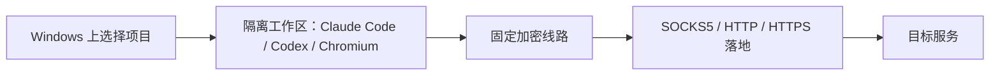
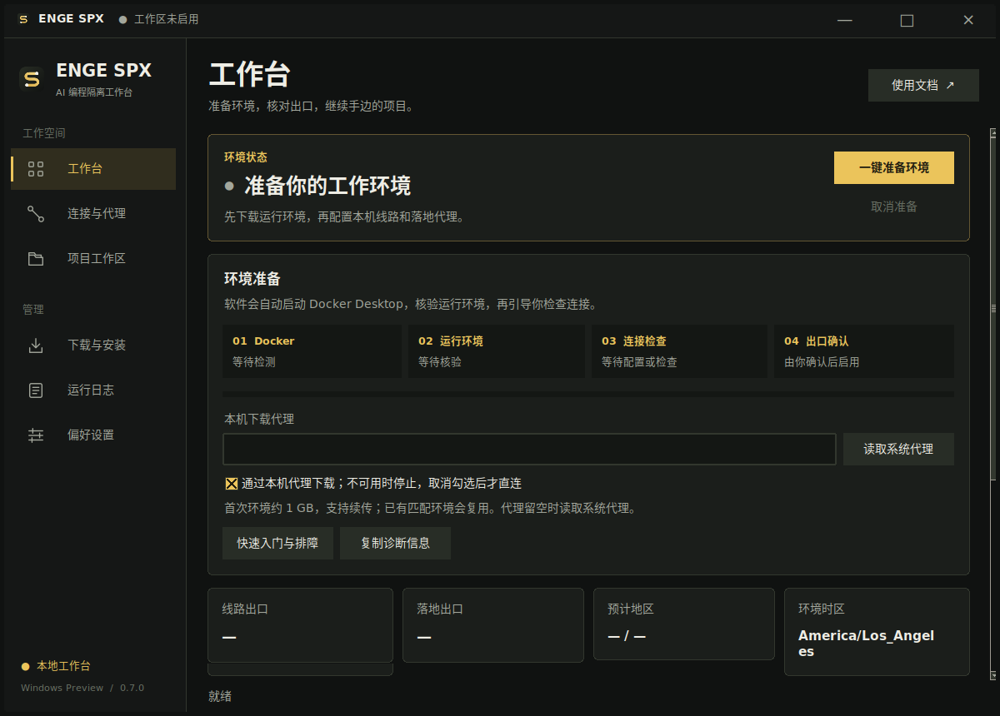

<p align="center"></p>
<h1 align="center">ENGE SPX</h1>
<p align="center"><strong>Windows 上的 AI 编程隔离工作台</strong></p>
<p align="center">让 Claude Code、Codex 和浏览器在独立容器环境中，通过你指定的代理出口工作。</p>
<p align="center"><strong>简体中文</strong> · <a href="README.en.md">English</a></p>
<p align="center">
  <a href="https://github.com/engeeeee/ENGE-SPX/actions/workflows/ci.yml"></a>
  <a href="https://github.com/engeeeee/ENGE-SPX/releases"></a>
  <a href="https://github.com/engeeeee/ENGE-SPX/releases"></a>
  <a href="LICENSE"></a>
</p>

**ENGE SPX 用来搭建一个与 Windows 日常环境分开的 AI 编程工作区。** 你选择项目、线路和落地代理，它负责准备 Linux 容器、检查出口，再启动 Claude Code、Codex 与共享 Chromium。工具依赖、工作区浏览器资料和网络配置集中在这套环境内，无需逐个改动本机工具的代理设置。

它适合希望在 Windows 上使用 AI 编程工具，同时**减少本机文件与日常浏览器资料暴露、固定工作区代理路径，并在连接异常时停止环境**的使用者。项目文件仍在你自己的电脑上；AI 服务账号、线路和落地代理由你提供。

## 三项核心能力

| 核心能力 | 它能帮你做什么 |
| --- | --- |
| **容器化 AI 工作区** | 在 Linux 容器运行 Claude Code、Codex 和浏览器；项目按需挂载，工具依赖与 Windows 日常环境分开，浏览器资料独立保存 |
| **固定线路＋落地双跳** | 在软件内组合加密线路与 SOCKS5 / HTTP / HTTPS 落地，约束工作区出网路径；推荐模式不配置直连或自动回退，也提供外部 v2ray 兼容模式 |
| **出口核验与异常停止** | 分别核对线路和落地出口，由你确认后启用；运行期间检测连接、拓扑与出口变化，发现异常后停止本环境 |



图示为“软件内双跳”模式。兼容模式交由本机 v2ray 等客户端转发，目标分流仍由该客户端决定。

## 隔离如何保护你的工作流

ENGE SPX 从文件、进程、浏览器资料和网络四个层面减少日常环境与工具环境的直接接触：

- **缩小文件暴露范围**：工具容器只挂载选中的项目；浏览器不挂载项目或工具账号卷，未选中的本机目录不主动共享。
- **限制容器权限**：不向工具挂载 Docker 管理接口，移除 Linux capabilities，启用 `no-new-privileges`；网关使用只读根文件系统与只读配置。
- **控制工作区网络路径**：工作容器接入内部网络，网关承担外联；固定双跳模式无 DIRECT 备用出口，诊断入口仅在网关回环监听。
- **保留可核对的连接证据**：线路与落地出口分别检查，配置变化后重新确认，后台监测发现异常后停止环境。

**边界同样明确**：所选项目读写共享，工具仍能修改或删除真实文件、读取项目内密钥；工具账号和工作区浏览器资料在项目间共享。容器依赖 Docker / WSL 和宿主机，无法抵御已被控制的宿主机，也不提供匿名保证。Chromium 当前使用 `--no-sandbox`，代理凭据尚未接入 Windows 凭据库加密。监测有周期和超时，不能承诺瞬时发现出口变化。

详见 [隔离与安全模型](docs/security-model.zh-CN.md)。当前为未签名 **Preview**，尚未经过独立安全审计或用户实机组合的完整交互验收。



截图来自真实源码界面的 Linux 图形测试环境，不代表 Windows 实机验收。

## 下载和开始使用

支持 **Windows x64**；需要 Docker Desktop 的 **Linux containers / WSL 2** 后端，Docker Engine **28+**。工作区是 Linux 容器，不是 Windows 虚拟机。打包版本不需要另装 Python。

打开 [Releases 下载](https://github.com/engeeeee/ENGE-SPX/releases)：

| 下载项 | 用法 |
| --- | --- |
| `ENGE-SPX-Windows-x64-0.6.0-Setup.exe` | 当前用户安装，带开始菜单和桌面快捷方式 |
| `ENGE-SPX-Windows-x64-0.6.0-Portable.zip` | 完整解压，运行 `ENGE-SPX.exe`，保留 `_internal` 目录 |
| `spx.exe` | 两种包都包含的命令行入口 |

1. 首次安装 [Docker Desktop](https://docs.docker.com/desktop/setup/install/windows-install/)，完成它的许可和 WSL 初始化。
2. 打开 ENGE SPX，点击 **一键准备环境**。软件自动启动已安装的 Docker，等待 Linux 引擎就绪，再复用或下载运行环境。
3. 添加落地，按需导入加密线路，选择“软件内双跳”或明确的 v2ray 兼容模式。
4. 检查连接，核对线路出口、落地出口和时区，确认后选择项目、启动工具。

打开软件会自动检查 Docker，但首次运行环境下载由你点击开始；进度可见、可以取消。它不会自动安装 WSL、重启系统或修改全局 Docker 上下文。缺少 Docker 或初始化未完成时，界面提供对应入口和说明。

详细步骤见 [快速入门](docs/quickstart.zh-CN.md)，代理 URI、JSON、Clash、订阅和协议范围见 [代理配置](docs/proxies.zh-CN.md)。

## 让日常使用更顺手

核心工作流之外，ENGE SPX 还提供：

- **下载管理**：本机代理下载、进度与速度、暂停续传、SHA-256 和镜像配方核验；代理不可用时不自动退回直连。
- **自己的终端**：支持 Pebrel、Windows Terminal、PowerShell 或自定义 exe 与参数模板，工具仍在容器中运行。
- **跨盘存储**：应用配置、日志和下载缓存可迁移到 D 盘；Docker 数据盘另有迁移助手和原资源核验。
- **已有数据复用**：匹配的镜像、项目容器、工具账号与浏览器卷保留；版本升级或配置改变后按要求重新检查出口。
- **诊断与命令行**：复制不含节点凭据的诊断摘要，也可用 `spx start` 完成准备和检查，再执行 `spx confirm` 明确确认。

下载代理与工作区链路分别配置，源码构建使用 Docker Desktop 自己的网络。应用数据迁移不会自动移动 Docker 数据盘。具体操作见 [存储与终端设置](docs/storage-terminal.zh-CN.md)。

## 文档与支持

| 内容 | 文档 |
| --- | --- |
| 安装、自动启动、首次配置 | [快速入门](docs/quickstart.zh-CN.md) |
| 代理导入与协议支持 | [线路与落地配置](docs/proxies.zh-CN.md) |
| v2ray 兼容和双跳限制 | [线路保护](docs/line-protection.zh-CN.md) |
| 文件、账号与网络边界 | [隔离与安全模型](docs/security-model.zh-CN.md) |
| D 盘迁移、Pebrel 和恢复 | [存储与终端](docs/storage-terminal.zh-CN.md) |
| 下载、Docker 凭据等问题 | [安装排障](docs/installation-troubleshooting.zh-CN.md) |
| 旧版数据接管 | [升级说明](docs/migration.zh-CN.md) |
| 源码、测试和构建 | [开发说明](docs/development.md) · [贡献指南](CONTRIBUTING.md) |
| 问题反馈与漏洞 | [支持指南](SUPPORT.md) · [安全报告](SECURITY.md) |

关闭窗口后，已确认环境和监测进程继续运行；结束工作请点击“停止环境”或执行 `spx stop`。停止和卸载不会主动删除项目或 Docker 数据卷。版本管理与备份仍由使用者负责。

## 开发与项目状态

项目由 [engeeeee](https://github.com/engeeeee) 个人维护。当前重点是 Windows x64、受控代理链路和已有数据兼容。暂不提供 Windows ARM64 安装包、任意协议传输支持、自动更新器或账号匿名保证。WS / gRPC / Reality / XTLS / uTLS 等未支持参数会明确拒绝，详见协议说明。

源码需要 Python 3.12+ 和 Tcl/Tk：

```powershell
python -m venv .venv
.\.venv\Scripts\python.exe -m pip install -e .
.\.venv\Scripts\spx.exe
```

Windows 安装包使用 PyInstaller 和 Inno Setup 构建。CI 包含 Windows / Linux 测试、Windows GUI 与安装卸载检查、实际 Linux Docker 链路和两种镜像存储验证。本版结果与下载摘要见 [0.6.0 验证记录](docs/validation-0.6.zh-CN.md)；检查范围与实机验收的区别见 [开发说明](docs/development.md)，功能变化见 [CHANGELOG](CHANGELOG.md)。

## 许可与来源

本项目使用 [PolyForm Noncommercial 1.0.0](LICENSE)，属于**非商业许可的源码公开项目**，不属于 OSI 定义的开源许可。个人品牌和独立仓库不会移除来源与第三方义务；历史说明见 [NOTICE](NOTICE.md)，组件条款见 [THIRD_PARTY_NOTICES](THIRD_PARTY_NOTICES.md)。
