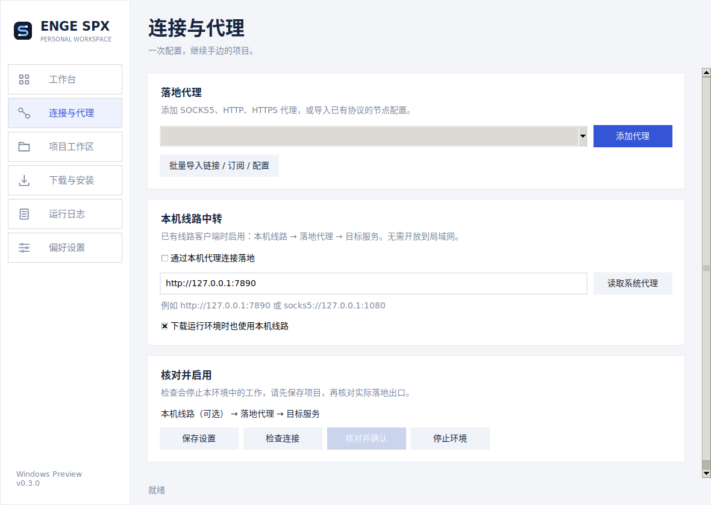

# ENGE SPX 的项目标识

项目名称为 **ENGE SPX**，维护者为 **engeeeee**，独立仓库地址为
[engeeeee/-enge-spx](https://github.com/engeeeee/-enge-spx)。新仓库使用独立的
Git 提交起点，没有连接原仓库的 fork 网络。

| 位置 | 当前名称 |
| --- | --- |
| 桌面窗口、开始菜单、快捷方式 | ENGE SPX |
| 图形程序 | ENGE-SPX.exe |
| 命令行 | spx.exe / spx.cmd |
| Python 包 | enge_spx |
| Windows 任务栏标识 | ENGE.SPX |
| 新安装程序目录 | LocalAppData/Programs/ENGE-SPX |
| 新安装设置目录 | LocalAppData/ENGE-SPX |
| 新容器前缀 | spx- |
| 新 Docker 标签 | io.enge.spx.* |

图标由本项目新绘制的 [SVG](../assets/logo.svg) 生成。深蓝底色上的 S 形连接线
与两个端点对应线路转发，图标没有复用此前上游的图形。可执行
`tools/render_brand.py` 重建 PNG 和多尺寸 ICO。

以下截图是源码界面在 Linux 图形测试环境中的实际初始状态，没有填入演示
出口、代理凭据或用户项目。Windows 程序另由原生 Windows CI 构建和启动验证。

旧名称仅在 [来源说明](../NOTICE.md)、第三方记录及明确的升级兼容代码中保留，
用于识别此前已经发布的资源。独立品牌与独立托管不改变第三方作者的版权和
许可证，也不表示所有依赖或设计思路均为本项目从零编写。
