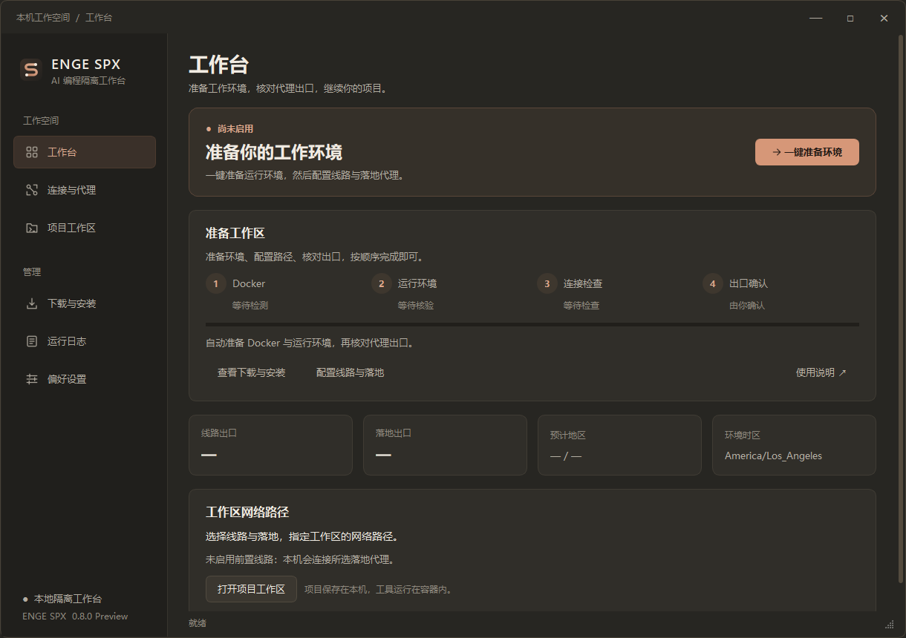
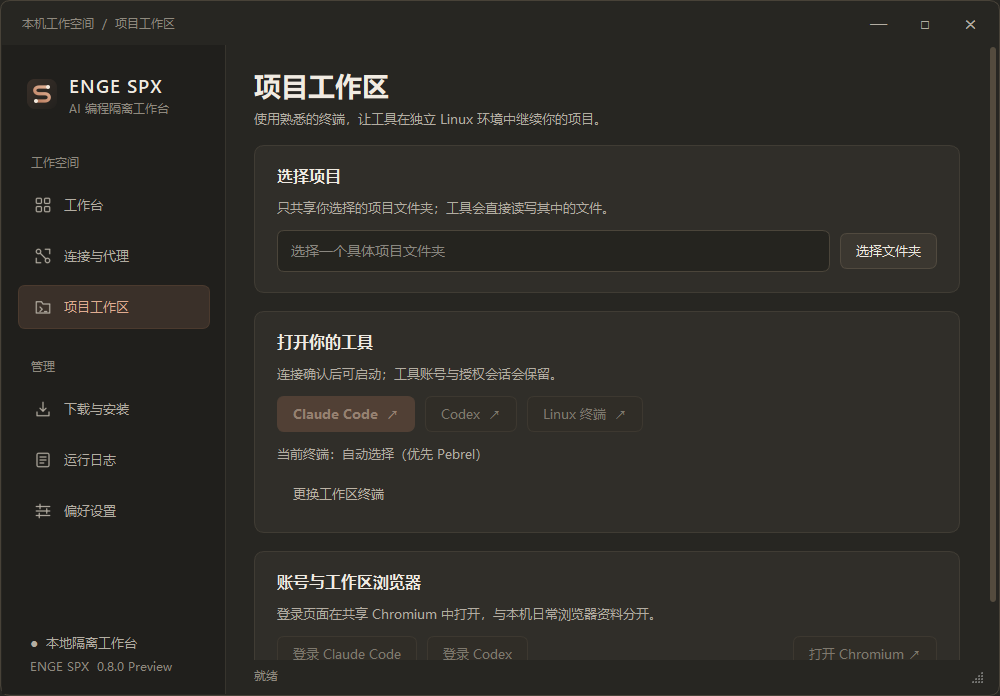

# ENGE SPX 的项目标识

项目名称为 **ENGE SPX**，维护者为 **engeeeee**，独立仓库地址为
[engeeeee/ENGE-SPX](https://github.com/engeeeee/ENGE-SPX)。新仓库使用独立的
Git 提交起点，没有连接原仓库的 fork 网络。

| 位置 | 当前名称 |
| --- | --- |
| 桌面窗口、开始菜单、快捷方式 | ENGE SPX |
| 图形程序 | ENGE-SPX.exe |
| 命令行 | spx.exe / spx.cmd |
| Python 包 | enge_spx |
| Windows 任务栏标识 | ENGE.SPX |
| 新安装程序目录 | LocalAppData/Programs/ENGE-SPX |
| 新安装设置目录 | LocalAppData/ENGE-SPX |
| 新容器前缀 | spx- |
| 新 Docker 标签 | io.enge.spx.* |

图标由本项目新绘制的 [SVG](../assets/logo.svg) 生成。暖深灰底色上的陶土色 S 形连接线
与两个端点对应线路转发，图标没有复用此前上游的图形。可执行
`tools/render_brand.py` 重建 PNG 和多尺寸 ICO。

0.8.0 的桌面界面使用 Qt 原生控件，统一暖深灰背景、低饱和陶土橙、暖白文字
与轻量卡片。文字按实际宽度排版，窄窗口收起侧栏文字，并在标题栏显示完整
产品名；准备步骤和指标区按宽度重排。次要页面按需创建，相同状态不反复刷新。
主窗口与软件内弹窗使用自定义标题栏；移动、缩放和窗口状态交由 Qt 与系统处理。
文件与文件夹选择继续使用系统对话框。颜色来自本项目的主题定义，产品名称
和图形标识仍为 ENGE SPX，不代表与 Claude / Anthropic 有官方关系。

以下图像来自 0.8.0 受测源码在原生 Windows CI 中运行的真实 Qt 界面，
没有填入演示出口、代理凭据或用户项目。完整截图、125% / 150% / 200%
缩放检查及覆盖范围见 [0.8.0 验证记录](validation-0.8.zh-CN.md)。

旧名称仅在 [来源说明](../NOTICE.md)、第三方记录及明确的升级兼容代码中保留，
用于识别此前已经发布的资源。独立品牌与独立托管不改变第三方作者的版权和
许可证，也不表示所有依赖或设计思路均为本项目从零编写。
