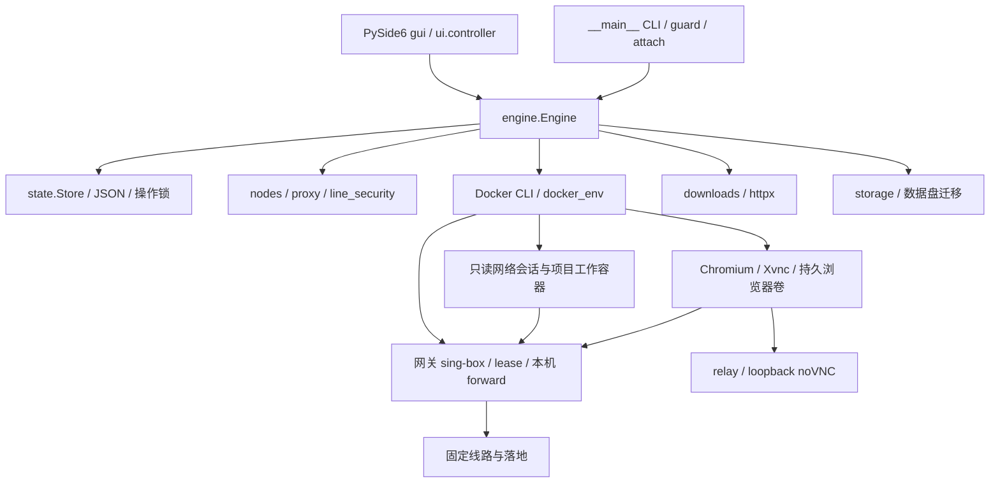

# 0.8.2 源码审计与第一批实施方案

审计起点：`c08beb1f3224150d95dbc1c5fb05e1283ff9c5ff`，2026-11-10。
本记录为源码审计与工程验证，不是独立第三方安全审计。

## 模块和依赖

核心运行依赖为 Python 标准库、PySide6 Essentials、httpx / socks、websockets、
PyYAML 与 tzdata。界面与 CLI 分离，CLI 和监测入口不导入 Qt。

## 实际实现与缺口

| 任务 | 现有实现位置和已具备能力 | 缺口 / 风险 | 复杂度与依赖 |
| --- | --- | --- | --- |
| A Chromium 沙箱 | `resources/containers/browser.py`、`Dockerfile.browser`；UID 1000；`engine.ensure_container` 移除 capabilities、禁止新增权限；浏览器不挂载项目或工具卷 | 显式 `--no-sandbox`；Docker 默认 seccomp 阻止新 namespaces；不能只删参数就声称修复 | 高；内核 user namespaces、Docker seccomp、宿主 LSM；优先做实际启动探针 |
| B 凭据 | `state.py` 原子写入、文件权限；`storage.py` 私有目录 ACL；下载错误大多已脱敏 | 节点、设置、网关配置、运行描述含敏感数据；网关配置明文只读挂载；内部浏览器令牌出现在 Docker argv | 高；Windows DPAPI、版本化迁移、容器 tmpfs、CLI 交互启动兼容 |
| 协议扩展 | `nodes.py` 已支持 SS / VMess AEAD / Trojan / TLS VLESS TCP / SOCKS5 / HTTP(S)、Clash 子集和 HTTPS 订阅；`line_security.py` 固定双跳 | Reality、WS、gRPC、Hysteria2 明确拒绝；尚无后端适配层 | 高；第二批评估现有 sing-box 优先，真实 TLS / QUIC / UDP 与 DNS 集成测试后才声称支持 |
| Fail-Closed | `engine.check / confirm / ready / audit_topology`、`lease.py`、网关监督程序；双出口、直连阻断、固定第一跳、无 DIRECT、失联到期 | 现有实际检测主要为 IPv4 TCP；需补 UDP / IPv6 / DNS / 浏览器行为证据 | 中到高；保留现有生命周期与测试，不通过降低监测换性能 |
| 资源 | GUI 按需建页、状态去重、空闲停止消息投递；项目 4 GiB、浏览器 2 GiB、会话 128 MiB、PID 上限；会话复用、并行探针、转发背压 | 缺 CPU 配额、可视化预算与统计；启动 CLI 会预先启动浏览器；WSL 整体占用未分层展示 | 中到高；第三批建立同机基线，明确应用 / Docker / WSL 来源 |
| 多 Profile | 项目独立目录挂载；所有项目共享 `tools-home`、`browser-home` 和 downloads 卷；独立数据目录可分开整个实例 | 缺轻量的项目身份模型、只读挂载选择和按身份凭据隔离 | 高；第四批先做数据与身份模型，保留默认共享模式 |
| 诊断 | `startup.diagnostics` 不输出账号、路由、项目路径和任意错误消息；GUI 有受限本地故障日志 | 缺 IPv6 / DNS / WebRTC / 语言 / 时区 / 分层延迟证据 | 中；第四批显式选择语言和时区，不做不可验证指纹伪装 |

## 第一批文件级方案

### A：浏览器沙箱

- `resources/containers/browser.py`：移除关闭沙箱参数，非 root 启动；启动前后检查沙箱，失败明确退出，不进行降级重试。
- `resources/containers/Dockerfile.browser`：保留既有浏览器资料卷和字体选择，补齐安全启动所需资源。
- 新增浏览器专用 seccomp 资源与宿主验证模块：从固定版本 Docker/Moby 默认 allowlist 派生，只加入已验证需要的 namespace 调用，保留其它拒绝项；不授予 SYS_ADMIN，不使用 privileged 或 unconfined。
- `engine.py`：只对浏览器使用该配置，审查用户、capabilities、seccomp、只读根文件系统及挂载；不接受旧的无沙箱浏览器作为安全运行时。
- `tests/` 与独立 CI 探针：读取 Chromium 实际沙箱状态及 renderer 内核状态，覆盖初始化失败、登录回调、VNC 和 Profile 保留。
- 不支持的内核或 LSM 明确禁用容器浏览器；设计显式 CLI-only 路径，不自动换成本机浏览器或无沙箱模式。

### B：凭据与迁移

- 新增 `credentials.py`：仅使用标准库调用 DPAPI，当前用户范围、禁止 UI、绑定安装标识和逻辑文件名的 entropy；不使用 machine-wide 保护，不引入密码学依赖。
- `state.py`：敏感 JSON 使用版本化加密封套，对外保持现有字典 / 列表结构和节点 ID；旧明文可识别并迁移，解密或权限失败不清空配置、不降级写明文。
- `engine.py`、网关启动资源：生成配置保留在内存，通过 Docker exec 的 stdin 送入网关 tmpfs；宿主保留加密配置用于策略核对，挂载中只提供非敏感租约。
- `engine.py`、`__main__.py`、`terminal.py`：必要的内部令牌通过 Docker 子进程环境按变量名传递，避免值出现在 argv；终端从公共 CLI 入口接入已准备的容器，不让第三方终端承担秘密转交。
- `redaction.py`、错误边界：已知密码、UUID、令牌与 URL userinfo 脱敏；机密 stdin 操作不转发可能回显数据的 stderr。
- 删除节点或清空凭据时停止旧网关、清除派生配置及运行描述的持久化引用；账号卷和项目不删除。
- `storage.py`、迁移测试：同一 Windows 账户跨盘迁移继续可读；加密失败、写入失败、错误账户或损坏密文均保留数据并报错。
- 版本化迁移支持中断后继续；不生成无人管理的明文备份。旧程序不能直接读加密封套，回滚需要保留能解密的工具并由用户显式授权导出旧格式到私有目录。

Linux 没有 DPAPI，本批继续使用明确标示的私有目录 / 文件权限保护；不以自制密钥文件或伪加密冒充系统凭据保护。Docker 管理者及受信任宿主在运行时仍可接触容器使用的必要凭据。

## 验证和性能方法

先运行单独的沙箱可行性探针，再逐项提交；Windows CI 使用真实 DPAPI，Linux 使用真实 Docker。原有单元、GUI、双跳、190 秒续期、迁移与两种镜像存储检查继续适用。

性能对比使用同一 CI 主机、相同项目与浏览器负载：记录 0.8.2 与新版本的进程数、RSS、Docker stats、浏览器首次就绪时间、凭据读写耗时和持久化字节数。区分 Linux CI、Windows 原生进程及无法在此环境实测的 Docker Desktop / WSL 整体，不提供预设提速百分比。

本批验证结束后更新 README、SECURITY、CHANGELOG、开发说明和验证记录；P1/P2 的协议、资源、Profile 与诊断按后续批次推进。

## 主要依据

- [Chromium Linux Sandboxing](https://chromium.googlesource.com/chromium/src/+/main/docs/linux_sandboxing.md)
- [Chromium AppArmor userns 限制](https://chromium.googlesource.com/chromium/src/+/main/docs/security/apparmor-userns-restrictions.md)
- [Docker seccomp](https://docs.docker.com/engine/security/seccomp/)
- [Microsoft CryptProtectData](https://learn.microsoft.com/en-us/windows/win32/api/dpapi/nf-dpapi-cryptprotectdata)
- [Microsoft CryptUnprotectData](https://learn.microsoft.com/en-us/windows/win32/api/dpapi/nf-dpapi-cryptunprotectdata)
