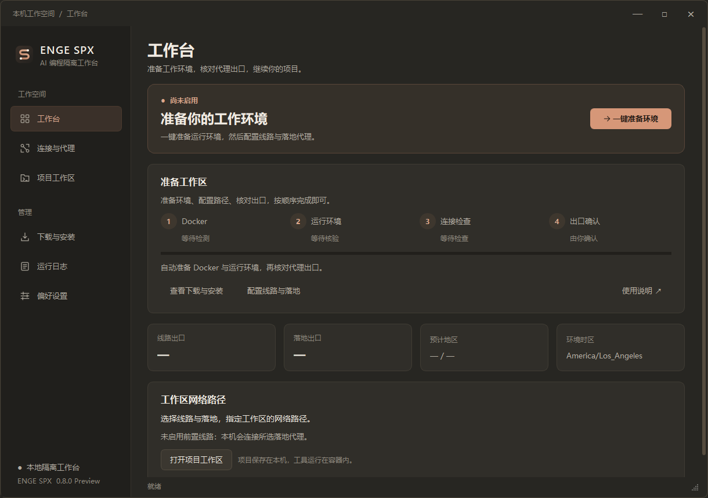

# 0.8.0 界面重构与发布验证

验证日期：2026-11-09。版本为 **0.8.0 Preview**。

- [Windows 安装版、便携版与校验文件](https://github.com/engeeeee/ENGE-SPX/releases/tag/v0.8.0-windows)
- [完整受测构建](https://github.com/engeeeee/ENGE-SPX/actions/runs/42637404474)，所有任务成功。
- 发布标签与受测源码均为 `0ceb0067215cd2ec77fce585ec7bfda1b6250771`。
- [原生 Windows 界面、缩放截图与检查结果](https://github.com/engeeeee/ENGE-SPX/actions/runs/42637404474/artifacts/13683602733)。

## 本次变化

桌面界面迁移到 PySide6 / Qt，采用暖深灰、陶土橙与暖白文字，统一页面、
表单、按钮和软件内弹窗。产品名按实际文字宽度排版；窄窗口将完整品牌
移到标题栏，准备步骤和指标区随宽度重排。主窗口保留自定义标题栏，
通过 Qt 与系统处理移动、缩放、最小化和最大化。

次要页面首次访问时才创建；相同状态不重复更新视图，后台消息限量分批
交给界面，空闲时停止消息投递计时器。Docker 检测、环境获取、代理与出口
检查、项目工具、终端选择和存储迁移继续沿用原有核心逻辑。

## 验证结果

| 检查 | 结果 |
| --- | --- |
| Windows Python 3.12 | 运行 127 项测试，2 项按平台跳过，其余通过 |
| Linux Python 3.12 | 运行 127 项测试，6 项按平台跳过，其余通过 |
| 实际界面操作 | 页面切换、节点表单绑定、异步准备与取消、迁移后的窗口身份通过 |
| 品牌与布局 | 普通窗口及 125% / 150% / 200% 独立缩放进程均检查完整产品名、主按钮可见及窗口工作区范围 |
| 窗口与弹窗 | 最小化、最大化、还原、模态确认和取消通过；确认弹窗默认回车为取消 |
| 空闲刷新 | 检查期间重复状态视图更新为 0，后台消息投递计时器在空闲时停止 |
| 真实程序入口 | 源码与实际打包 GUI 完成自动启动独立假 Desktop、焦点与主题通知、就绪后的响应及正常关闭检查；新管理 CLI 与旧 Desktop 回退均通过 |
| 打包运行时 | CLI 自检为 Python 3.12.10，GUI 与 CLI 为 Windows x64，产品版本为 0.8.0 Preview |
| 安装卸载 | 当前用户安装、快捷方式、安装后 CLI 和卸载保留私有数据通过 |
| Linux 容器 | 实际 Docker 完成双出口核对、直接出网阻断、Chromium / VNC / 登录回调、租约到期、停止与迁移后资料保留检查 |
| 代理链路 | 本机 HTTP 前置、带认证 SOCKS / HTTP 落地及软件内加密双跳通过；检查远端落地 DNS、故障阻断与 NO_PROXY 污染 |
| 预构建环境 | 完整归档在 containerd 与 classic 两种镜像存储完成导入与重复安装，保留已有标签和容器数据 |

打包 GUI 的内部首次显示检查记录为 **768 ms**。计时从 GUI 初始化函数
开始，未包含进程启动、导入与 DLL 加载、Docker 初始化、环境下载或出口
检查；这不是端到端冷启动耗时，也不能用作不同电脑之间的性能保证。

Desktop 自动启动检查使用隔离的假 CLI 与独立桌面进程；实际容器集成在
Linux Docker 中运行。尚未代替用户电脑的真实 Docker Desktop / WSL
首次初始化、多显示器、v2ray 和 Pebrel 组合交互验收。容器配方与 0.7.1
相同，已有匹配镜像可继续复用。

## 公开下载核验

发布后使用程序相同的 HTTPS 客户端，从公开地址完整下载安装版、便携版、
运行环境清单与校验文件。文件长度和 SHA-256 与 GitHub 资产摘要一致；
便携 ZIP 完整性、两个程序入口的 x64 PE 与版本信息、Qt DLL、说明和
第三方许可证均已检查。包内已移除 Tk 运行库。

| 资产 | 字节数 | SHA-256 |
| --- | ---: | --- |
| ENGE-SPX-Windows-x64-0.8.0-Setup.exe | 32,059,746 | `ae47f25ab2459b1d3991c6a72a98935ea9e4e65a643961aa19ec58678c3a1c92` |
| ENGE-SPX-Windows-x64-0.8.0-Portable.zip | 50,350,781 | `f00a0ac98cb2a35a4c77bb22c071cb9f62eaf341b44880e49ad733c7ebcec430` |
| ENGE-SPX-Runtime-linux-amd64-0.8.0.tar.gz | 949,424,628 | `66b190c9d8b69442acb6e5db3476dee65b969b39335f8a5fc7fc62f1d61a19de` |

约 949 MB 的完整运行环境已在 CI 校验并导入两种镜像存储，发布后未在本地
重复完整下载。公开清单的配方与源码一致，归档大小和摘要与 CI 及 GitHub
元数据一致；公开 Range 请求返回正确总长度及有效 gzip 头。

## 升级与边界

先退出旧版 ENGE SPX，再安装或解压新版，避免单实例机制唤起仍在运行的
旧窗口。便携版需完整解压并保留 `_internal`。无需为本次界面升级删除
Docker 镜像、配置或项目。

软件仍为未签名的 Preview。Qt / PySide 的许可证、归属与对应源码地址见
[第三方说明](../THIRD_PARTY_NOTICES.md)及随包 `licenses` 和
`THIRD-PARTY-LICENSES/Qt`。界面重构不扩大隔离保证，共享项目、账号与
网络监测范围仍见 [安全模型](security-model.zh-CN.md)。本地故障日志
位置与排查步骤见 [安装排障](installation-troubleshooting.zh-CN.md)。
