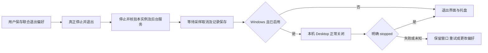

# 可选联合退出交付与验证

基线 0.12.0，`221f59fddeab2570bf462c76cb4965c7fd2e8dd9`；源码候选 `63e79f3`。最终同次构建结果在完成后补记；跳过检查不计为通过。风险与文件方案见 [审计](desktop-exit-plan.zh-CN.md)。

## 1. 修改概述

新增默认关闭的联合退出设置。Windows 真正退出时可在本实例工作区核验停止、资源查询及性能记录保存后正常关闭 Docker Desktop。不改变 Engine 的本实例停止接口、X 隐藏或显式保留工作区退出，不增加生产依赖、权限、端口、镜像配方或许可证变更。

## 2. 源代码文件

`src/enge_spx/desktop_shutdown.py` 管理独立 schema=1 公开退出偏好、官方 CLI 调用、全流程超时和明确状态确认；`ui/controller.py` 串行收尾、异步关闭、失败重试与偏好保存；`ui/window.py` 增加控件及退出状态说明。`test_desktop_shutdown.py`、`test_exit_lifecycle.py`、`test_resource_recording_ui.py`、`test_window_frame.py` 覆盖核心及 Qt 顺序；`desktop_harness.py`、`test_gui_startup.py` 验证原生 Windows 源码/冻结进程；DPI、同机测量和发布门禁复用既有机制。

## 3. 核心架构与技术方案



Desktop 管理命令不带 Docker context，不注入工作区运行令牌；不使用 force、后台进程终止、WSL shutdown 或重启作为兜底。[官方 stop](https://docs.docker.com/reference/cli/docker/desktop/stop/) / [status](https://docs.docker.com/reference/cli/docker/desktop/status/) 支持同步停止和 JSON 状态；命令及后续确认均有界，连接失败不代表已关闭。

保存是独立后台操作，不构造或解密 Engine；权限失败不替换旧设置，排队退出随保存失败取消。关闭确认失败后，保留没有新 Engine 操作且运行状态仍停止的原核验结果；再次操作或运行记录改变时失效，避免重新启动 Docker 才能退出。偏好缺失默认为 false，旧程序忽略新文件，取消并保存即可回滚。

## 4. 已实现功能

默认未选中开关和显式保存、已保存/未保存反馈、菜单文字、X/保留工作区豁免、记录保存顺序、正常关闭/已关闭/停止中状态、超时/权限/旧版本失败保留界面及重试；明确说明会中断其它 Docker 工作负载。Linux 不执行 Windows Desktop 管理。不以关闭 Desktop 代替正常工作区停止。

## 5. 测试命令与实际结果

```bash
python tools/check_repository.py
PYTHONPATH=src python -m unittest discover -s tests -v
PYTHONPATH=src python tools/smoke_gui.py
PYTHONPATH=src python tools/check_ui_dpi.py
python tests/test_gui_startup.py --packaged dist/ENGE-SPX/ENGE-SPX.exe
python tools/benchmark_p0.py --kind host --baseline 221f59fddeab2570bf462c76cb4965c7fd2e8dd9 --output host.json
```

本地 Linux ARM64 344 项（332 通过、12 项 Windows 专用跳过）、Qt smoke 与 200% 紧凑布局包括新控件通过。[完整 PR CI](https://github.com/engeeeee/ENGE-SPX/actions/runs/42976115035) 的两平台单元已通过：Windows 344 项（340 通过、4 项平台跳过），Linux 344 项（332 通过、12 项平台跳过）。12 项关闭核心测试、退出生命周期、实际记录落盘后调用关闭及 Qt 控件保存等通过。Windows 源码真实 GUI/独立进程夹具验证默认保留、显式关闭、X 隐藏保留 Desktop、Ctrl+Q 先核验工作区再正常关闭、数据保留和无额外启动；125/150/200% DPI 包括新退出控件均通过。它们没有操作真实 Docker Desktop。

冻结程序、完整容器安全阶段及主分支同次发布结果完成后补记。PR 按规则跳过的导出、两种镜像存储导入和发布不计为通过。只有主分支同次全部检查通过才发布。

## 6. 修改前后性能对比

默认不关闭，不新增轮询或常驻进程；仅在真正退出且已保存选择时增加有限管理调用。镜像配方与资源预算不变。[原生测量 CI](https://github.com/engeeeee/ENGE-SPX/actions/runs/42976072518) 两个平台的 12 项核心关闭检查及三组同机 0.12.0/候选交替对照全部成功，Python 3.12，默认共享资料与 20 个合成节点，以下为中位数：

| 指标 | Windows 0.12.0 → 候选 | Linux 0.12.0 → 候选 |
| --- | --- | --- |
| GUI 导入/构造/首次绘制 | 278.636 → 206.989 ms | 152.462 → 127.689 ms |
| GUI 空闲单核 CPU | 0.6096% → 0.6123% | 0.2838% → 0.3018% |
| GUI 工作集 | 83.52 → 83.46 MiB | 90.75 → 90.38 MiB |
| 合成默认配置持久数据 | 7,902 → 7,902 B | 6,794 → 6,794 B |

每组空闲约五秒，受 VM 调度、工作集回收和冷暖缓存影响。基线来自新解压源码，候选为已运行检查的工作树，字节码/文件缓存条件不同；首绘差异不能独立归因于代码提速。空闲 CPU 略增、内存接近，不作改善比例或全面下降承诺。宿主对照没有运行真实 Desktop、AI 任务或联合关闭。

容器阶段结果在完整 CI 后补记。真实 Desktop 退出耗时、WSL2 缓存释放和磁盘增长仍须实机测量；独立模拟进程耗时不冒充真实 Desktop 性能。启用后偏好文件另占少量字节，不改变镜像或复制用户资料。

## 7. 遗留问题

Windows CI 的管理进程夹具不能代替用户的真实 Desktop/WSL2、其它 Docker 任务、升级/资源节省状态和企业权限策略验收。关闭 Desktop 不删除/压缩虚拟磁盘，不保证其它 WSL2 缓存归零。旧管理接口不兼容时明确失败；Preview 未签名，也无独立安全审计。

## 8. 下一批任务

先使用实机记录完成真实 AI 任务和交互 noVNC 的长时测试，覆盖睡眠/唤醒、断网、Docker 重启和可选联合退出；依据真实瓶颈优化延迟、吞吐、内存及磁盘。物理设备/真实账号、签名和独立审计需要相应外部条件，不能以合成或 Linux 结果冒充。继续保留必要安全监测。
