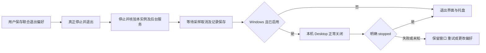

# 可选联合退出交付与验证

基线 0.12.0，`221f59fddeab2570bf462c76cb4965c7fd2e8dd9`；最终源码候选 `d02cd0f`。最终同次构建结果在完成后补记；跳过检查不计为通过。风险与文件方案见 [审计](desktop-exit-plan.zh-CN.md)。

## 1. 修改概述

新增默认关闭的联合退出设置。Windows 真正退出时可在本实例工作区核验停止、资源查询及性能记录保存后正常关闭 Docker Desktop。不改变 Engine 的本实例停止接口、X 隐藏或显式保留工作区退出，不增加生产依赖、权限、端口、镜像配方或许可证变更。

## 2. 源代码文件

`src/enge_spx/desktop_shutdown.py` 管理独立 schema=1 公开退出偏好、官方 CLI 调用、全流程超时和明确状态确认；`ui/controller.py` 串行收尾、异步关闭、失败重试与偏好保存；`ui/window.py` 增加控件及退出状态说明，窄设置页按钮纵排、长 Windows 路径在页内换行并保留自动高度。`test_desktop_shutdown.py`、`test_exit_lifecycle.py`、`test_resource_recording_ui.py`、`test_window_frame.py` 覆盖核心及 Qt 顺序；`desktop_harness.py`、`test_gui_startup.py` 验证原生 Windows 源码/冻结进程；DPI 增加整页、说明文字、长路径与已启用退出按钮的边界检查，同机测量和发布门禁复用既有机制。

## 3. 核心架构与技术方案



Desktop 管理命令不带 Docker context，不注入工作区运行令牌；不使用 force、后台进程终止、WSL shutdown 或重启作为兜底。[官方 stop](https://docs.docker.com/reference/cli/docker/desktop/stop/) / [status](https://docs.docker.com/reference/cli/docker/desktop/status/) 支持同步停止和 JSON 状态；命令及后续确认均有界，连接失败不代表已关闭。

保存是独立后台操作，不构造或解密 Engine；权限失败不替换旧设置，排队退出随保存失败取消。关闭确认失败后，保留没有新 Engine 操作且运行状态仍停止的原核验结果；再次操作或运行记录改变时失效，避免重新启动 Docker 才能退出。偏好缺失默认为 false，旧程序忽略新文件，取消并保存即可回滚。

## 4. 已实现功能

默认未选中开关和显式保存、已保存/未保存反馈、菜单文字、X/保留工作区豁免、记录保存顺序、正常关闭/已关闭/停止中状态、超时/权限/旧版本失败保留界面及重试；明确说明会中断其它 Docker 工作负载。Linux 不执行 Windows Desktop 管理。不以关闭 Desktop 代替正常工作区停止。

## 5. 测试命令与实际结果

```bash
python tools/check_repository.py
PYTHONPATH=src python -m unittest discover -s tests -v
PYTHONPATH=src python tools/smoke_gui.py
PYTHONPATH=src python tools/check_ui_dpi.py
python tests/test_gui_startup.py --packaged dist/ENGE-SPX/ENGE-SPX.exe
python tools/benchmark_p0.py --kind host --baseline 221f59fddeab2570bf462c76cb4965c7fd2e8dd9 --output host.json
```

本地 Linux ARM64 344 项（332 通过、12 项 Windows 专用跳过）、Qt smoke 与 200% 紧凑布局包括新控件通过；布局修正后 12 项 Qt 窗口回归和更严格的长路径/DPI 检查再通过。最终源码的 [完整 PR CI](https://github.com/engeeeee/ENGE-SPX/actions/runs/42978962228) 两平台单元已通过：Windows 344 项（340 通过、4 项平台跳过），Linux 344 项（332 通过、12 项平台跳过）。12 项关闭核心测试、退出生命周期、实际记录落盘后调用关闭及 Qt 控件保存等通过。Windows 源码真实 GUI/独立进程夹具验证默认保留、显式关闭、X 隐藏保留 Desktop、Ctrl+Q 先核验工作区再正常关闭、数据保留和无额外启动；125/150/200% DPI 包括新退出控件、说明文字与长路径均通过。它们没有操作真实 Docker Desktop。

同次 Windows 安装包已构建并通过冻结 CLI、实际记录、DPAPI 迁移/回滚/删除、默认手动 Docker 启动、安装/卸载保留数据，以及实际冻结 GUI 的托盘/Ctrl+Q、默认保留与显式正常关闭独立模拟 Desktop 进程。工作区停止日志先于 Desktop 停止，账号哨兵保留，未重新启动 Desktop。此处的 Desktop 仍是测试拥有的独立夹具。此次冻结 GUI 首绘 763 ms，没有同条件旧冻结包对照，不作提速结论。

完整 PR CI 已全部成功：真实 cgroup/数据复用、记录生命周期、身份数据/递归只读、停止后网络迁移/回滚、DNS/UDP/IPv6 防泄漏、协议/TLS/Reality/gRPC/QUIC；真实 Chromium namespace/PID/network/seccomp 与 renderer 内核证据、中文 PTY/无中文系统字体、190 秒无 shell 输入续期、租约过期停止、独立浏览器停启与 Cookie/Storage 保留、数据搬迁、全部归属服务停止、沙箱初始化失败拒绝；固定双跳、独立出口变化与 Hysteria2 UDP 断线保护；七项真实浏览器身份/诊断及所有资源阶段均通过。

PR 按规则跳过的导出、两种镜像存储导入和发布不计为通过。主分支会重新运行全部测试，并验证同次导出包在两种存储中的实际导入，全部通过才发布。最终发布与公开下载核验完成后补记；最终文档补记不改源码或测试。

## 6. 修改前后性能对比

默认不关闭，不新增轮询或常驻进程；仅在真正退出且已保存选择时增加有限管理调用。镜像配方与资源预算不变。最终源码的 [原生测量 CI](https://github.com/engeeeee/ENGE-SPX/actions/runs/42978958090) 两个平台的 12 项核心关闭检查及三组同机 0.12.0/候选交替对照全部成功，Python 3.12，默认共享资料与 20 个合成节点，以下为中位数：

| 指标 | Windows 0.12.0 → 候选 | Linux 0.12.0 → 候选 |
| --- | --- | --- |
| GUI 导入/构造/首次绘制 | 267.566 → 225.216 ms | 187.781 → 152.182 ms |
| GUI 空闲单核 CPU | 0.6136% → 0.6117% | 0.3123% → 0.3090% |
| GUI 工作集 | 83.68 → 83.17 MiB | 90.70 → 90.45 MiB |
| 合成默认配置持久数据 | 7,902 → 7,902 B | 6,794 → 6,794 B |

每组空闲约五秒，受 VM 调度、工作集回收和冷暖缓存影响。基线来自新解压源码，候选为已运行检查的工作树，字节码/文件缓存条件不同；首绘差异不能独立归因于代码提速。空闲 CPU 和内存接近，不作改善比例或全面下降承诺。宿主对照没有运行真实 Desktop、AI 任务或联合关闭。

同一完整 PR 的 Linux Docker runner，三个独立 worker 依次运行 0.12.0 正常、候选正常和候选低资源，复用同批已核验镜像/同一只读观察器，分别使用临时数据目录。下表是每阶段两次所属运行容器 Docker stats 内存总和的均值，减去部分缓存，不是 WSL2 全机内存：

| 容器阶段/内存 MiB | 0.12.0 正常 | 候选正常 | 候选低资源 |
| --- | ---: | ---: | ---: |
| 工具启动前，网关/会话 | 18.19 | 18.01 | 17.64 |
| 默认工具容器启动后空闲 | 248.97 | 250.57 | 18.02 |
| 合成 CPU/磁盘活动 | 253.89 | 253.86 | 25.08 |
| 显式 Chromium canvas 活动 | 279.32 | 282.25 | 284.42 |
| 单独停止浏览器，保留 CLI | 29.05 | 28.97 | 27.78 |
| 完全停止 | 0 个运行容器 | 0 个运行容器 | 0 个运行容器 |

正常模式没有全面下降。低资源空闲值来自原有浏览器懒启动，非本批新优化。合成双哈希线程 CPU 总和约 200.02% / 200.45% / 99.83%，保持原一核限额。工具容器准备单次 4.06 / 3.61 / 1.24 秒；随后首次显式启动低资源浏览器为 6.44 秒，前两组已运行浏览器操作为 0.70 / 0.74 秒，不是同条件冷启动对照。

离线 `claude --version` 三次中位数 12.42 / 12.23 / 12.33 ms，`codex --version` 41.57 / 41.63 / 41.68 ms，不含真实模型请求或编译。三组项目可写层同为 8,413,184 B（含合成 8 MiB 文件），浏览器 Profile 为 10,316,326 / 10,316,325 / 6,082,440 B；时点/缓存不同，不代表压缩。停止后应用数据为 918,796 / 918,792 / 919,214 B，不含全部卷与虚拟磁盘。原始 JSON 位于上述 CI 的 Resource-Measurements 和 Desktop-exit-native-* Artifact。

真实 Desktop 退出耗时、WSL2 缓存释放和磁盘增长仍须实机测量；独立模拟进程耗时不冒充真实 Desktop 性能。启用后偏好文件另占少量字节，不改变镜像或复制用户资料。完全停止只证明本实例没有运行容器，不代表 Windows、Desktop/WSL2 共享缓存或磁盘归零。

## 7. 遗留问题

Windows CI 的管理进程夹具不能代替用户的真实 Desktop/WSL2、其它 Docker 任务、升级/资源节省状态和企业权限策略验收。关闭 Desktop 不删除/压缩虚拟磁盘，不保证其它 WSL2 缓存归零。旧管理接口不兼容时明确失败；Preview 未签名，也无独立安全审计。

## 8. 下一批任务

先使用实机记录完成真实 AI 任务和交互 noVNC 的长时测试，覆盖睡眠/唤醒、断网、Docker 重启和可选联合退出；依据真实瓶颈优化延迟、吞吐、内存及磁盘。物理设备/真实账号、签名和独立审计需要相应外部条件，不能以合成或 Linux 结果冒充。继续保留必要安全监测。
