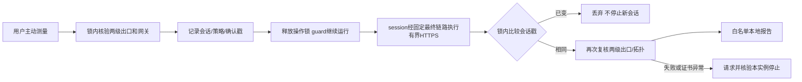

# 有界网络测量交付与验证

基线 0.12.1，`04b64bb450090e51246764bef8de8825146e2caf`；源码候选 `a9e6e1faedecaa9f0f6c2b7a9e1e43d291a3125e`，[PR #8](https://github.com/engeeeee/ENGE-SPX/pull/8)。PR 的全套源码、打包、容器门禁通过；主分支的最终发布及公开下载结果完成后补记。文件风险和边界见 [审计](network-measurement-plan.zh-CN.md)。跳过或未运行不计为通过。

## 1. 修改概述

增加主动、有限的最终链路 HTTPS 测量和本地报告，补充 Windows/WSL2 实机验收步骤。保留既有双出口、guard、沙箱、DPAPI、身份/预算、数据及可选 Desktop 退出。不增加生产依赖、权限、端口、镜像配方或许可证变更。

## 2. 源代码文件

`network_performance.py` 处理审计入口、前后核验、会话戳、字段白名单与统计；`resources/checks/network_probe.py` 是固定目标的标准库 HTTPS CONNECT 客户端；`engine.py` 提供独立入口。CLI、Qt 控制器/网络页增加主动按钮、缓存导出与失败状态；新增性能核心/CLI/Qt 单元和 `integration_network_transfer.py`，扩展实际 Engine 身份集成、DPI、冻结资源及发布门禁。

## 3. 核心架构与技术方案



不使用第一跳通用测速入口；只接受已审计网关的 IPv4:2080，不读取系统代理环境、不解析宿主 DNS、不接受自定义目标或跳过 TLS。子进程硬时限应对慢响应头；三次载荷及多读检测字节有上限。证书错误或安全复核失败不发布速度结果；目标拒绝/超时而复核健康可保留 partial。数据/镜像无需迁移。

## 4. 已实现功能

按需 GUI/CLI、两次新建 HTTPS 首字节、一份 1 MiB 下载、固定服务和流量/时间说明；结果/失败单位、脱敏导出、旧结果清除、前后独立核验、不阻塞 guard、切换竞态丢弃、真正退出等待收尾。见 [使用](network-measurement.zh-CN.md)和 [实机步骤](windows-acceptance.zh-CN.md)。

## 5. 测试命令与实际结果

```bash
python tools/check_repository.py
PYTHONPATH=src python -m unittest discover -s tests -v
PYTHONPATH=src python -m unittest discover -s tests -p 'test_network_performance*.py' -v
PYTHONPATH=src python tools/smoke_gui.py
PYTHONPATH=src python tools/check_ui_dpi.py
docker build -f tools/Dockerfile.proxy-test -t spx-proxy-test .
docker run --rm --network none --read-only --tmpfs /tmp:rw,nosuid,nodev,size=128m --cap-drop ALL --security-opt no-new-privileges --pids-limit 256 --memory 512m --entrypoint python3 spx-proxy-test -u /opt/spx-test/integration_network_transfer.py --core /usr/local/bin/sing-box --output /tmp/network-transfer.json
python tools/benchmark_p0.py --kind host --baseline 04b64bb450090e51246764bef8de8825146e2caf --output host-network-measurement.json
```

Linux GUI 使用 `QT_QPA_PLATFORM=offscreen`。历史对照要求本地 git 中存在基线提交；同机配对和顺序见专项 workflow，不把不同设备的数字混作优化幅度。完整真实 Engine、协议、打包和归档导入命令保留于 `.github/workflows/ci.yml`。

本地 Linux ARM64 365 项（353 通过、12 项 Windows 专用跳过）、Qt smoke、200% 布局及新测速控件通过。21 项性能核心/CLI/Qt 测试覆盖字段/计数/单位、强制代理、NO_PROXY、未知目标参数不回显、操作锁释放、前后失败/证书异常停止、会话改变不停止替换环境、旧结果不冒充本次、缓存导出及退出等待。

真实 Python 3.12 + 官方 sing-box 1.14.3 的无网络 Docker 中，9 场景通过：生产客户端实际经 Adapter 和认证落地完成精确载荷；错误 CA、可信但名称错误证书拒绝；302 不跳转；错误长度、gzip、超量流拒绝且有界；慢响应头无法延长总预算；落地停止后健康目标无新请求。临时 CA 只用于夹具，没有关闭证书/名称验证或发公网请求。测试专用 daemon 已停止。

跨平台实际结果：[完整 PR 检查](https://github.com/engeeeee/ENGE-SPX/actions/runs/43012952824)的 Linux 365 项（353 通过、12 跳过）和 Windows 365 项（361 通过、4 跳过）通过；Windows Qt smoke、125%/150%/200% 的全部既有控件和新测速控件通过。[专项测量](https://github.com/engeeeee/ENGE-SPX/actions/runs/43012945473)在两平台各 21 项通过，真实后端的 9 场景夹具通过，并保留原始三组宿主测量。

首次 Windows 运行发现新增测试用系统默认 cp1252 读取已正确写入的 UTF-8 中文报告；只修复测试的显式读取编码，重新完整验证。

同一 PR 的 Windows 冻结程序通过 self-test（包含 `network_probe.py`）、未准备状态的 `network-test`、GUI 首屏、真实 DPAPI 旧凭据迁移/删除、手动 Docker 启动及安装/卸载保留数据。冻结 GUI 首屏 799 ms，仅为这次 runner 的观察。

真实 Engine 使用已确认的受控 session 和本地加密代理夹具访问公网固定目标，报告 `checked/measured`：三次完整载荷合计 1,050,624 B，测量阶段 542.558 ms；两次冷 HTTPS 首字节中位数 229.951 ms，单次完整请求有效下载 104.089 Mbps。前后出口复核通过，guard 和 ready 状态保留，原始地址/凭据/路径未进入报告，宿主监听与容器发布端口没有增加。这些数值不是 v2rayN、物理 Windows、AI 或线路容量的验收，也没有旧版同类测速基线。资源 artifact 保存完整 `workspace-profiles-results.json`；目标拒绝/超时仍应记 partial，不能计作成功测速。

完整容器门禁还通过既有实际协议/TLS 名称/证书/认证、Reality 错误参数、Hysteria2 QUIC/分片 UDP/断 UDP、固定落地及第一跳中断、DNS/UDP/IPv6/宿主直连阻断、版本化网络迁移回滚、资源限制/记录/跨实例停止、真实 Chromium 内核沙箱、拒绝无沙箱回退、Cookie/Storage/账户身份隔离、中文 PTY、190 秒浏览器独立续期、过期租约停机与数据迁移。全部安全验证保留；真实服务账号和物理 Desktop/WSL2 不在这些结果中。

源码 PR 的发布任务按规则跳过；只有主分支同次安装包、容器和导出归档双 store 导入门禁成功才发布。

## 6. 修改前后性能对比

默认不测速，无新后台任务或镜像；只在用户明确触发时产生有界请求。首字节包含 CONNECT/TLS/服务响应，速率只有一份小响应，不测真实 AI、noVNC、物理 Windows/WSL2 或线路上限。

专项 CI 在各自同一 runner 上各做三组 0.12.1/候选独立进程对照，中间组反转顺序；下表为三组中位数。内存为测量 GUI 的工作集/RSS，CPU 为约 5 秒 GUI 空闲窗口、单核百分比；未启动 Docker。合成数据目录不包含真实账号或项目。

| 指标 | Windows 0.12.1 → 候选 | Linux 0.12.1 → 候选 |
| --- | --- | --- |
| Qt 导入、构造到首屏（ms） | 378.325 → 314.922 | 215.082 → 173.287 |
| GUI 空闲 CPU（单核 %） | 1.2205 → 0.8907 | 0.3454 → 0.3850 |
| GUI 工作集 / RSS（bytes） | 85,008,384 → 84,516,864 | 95,277,056 → 94,941,184 |
| Engine 构造（ms） | 9.799 → 9.260 | 2.569 → 2.683 |
| 合成应用持久文件（bytes） | 7,902 → 7,902 | 6,794 → 6,794 |

基线每轮从 git archive 新解压，候选目录已经过测试，字节码/文件缓存状态不同；反转顺序并不能消除这一偏差。短窗口和托管 runner 的负载也会波动，不能将较低首屏/CPU 数字解释为实际用户获得了确定提升。

同一 Linux Docker runner 依次启动三个独立 worker，共用已验证的不可变镜像；候选是 PR 合并测试提交 `07aec42ab9a2082c7181c8f69c24a0c0f5077f4e`。每阶段取两次样本均值，内存为运行中的本实例容器 Docker 统计之和（MiB），不含停止容器、主机或 WSL2 总量。短时间 CPU 样本可能包含启动残留活动。

| 阶段 | 0.12.1 正常 MiB / CPU % | 候选正常 MiB / CPU % | 候选低资源 MiB / CPU % |
| --- | --- | --- | --- |
| 工作区前 | 0 / 0 | 0 / 0 | 0 / 0 |
| 容器空闲、工具前 | 18.154 / 0.165 | 18.125 / 0.145 | 17.581 / 0.140 |
| 默认 CLI 启动后 | 248.912 / 0.355 | 248.285 / 3.670 | 17.827 / 0.030 |
| 合成 CPU + 8 MiB 文件写入 | 253.148 / 200.400 | 253.099 / 200.895 | 25.018 / 99.510 |
| Chromium canvas 活动 | 280.769 / 15.010 | 281.618 / 14.400 | 283.013 / 24.570 |
| 单独停止浏览器 | 29.172 / 0.040 | 29.032 / 0.040 | 28.176 / 0.035 |
| 工作区完全停止 | 0 / 0 | 0 / 0 | 0 / 0 |

两种正常模式默认 CLI 启动约 3,477.978 → 3,464.421 ms；完整停止约 604.597 → 768.526 ms，低资源完整停止 964.780 ms。所有组停止后的本实例运行容器数均为 0。正常模式浏览器 Profile 为 10,316,389 → 10,316,387 B，合成项目层均为 8,413,184 B，browser/session/gateway 可写层各为 4,096/4,096/8,192 B；这些是特定合成负载的磁盘观察。

低资源模式已有浏览器延迟启动与 CPU 限额；低资源 CLI 启动后少一个浏览器，不是本批增加的性能提升，canvas 阶段已显式启动浏览器。完整工具只测离线 `--version`，没有真实 Claude/Codex 服务任务或已连接 noVNC 客户端。本批没有重写代理传输、显示链路或镜像，没有足够证据声称持续网络/GUI 加速。

## 7. 遗留问题

固定公网目标可能限流或不可用。CI 临时 CA/本地代理夹具不代替实际服务商、Windows/WSL2/v2rayN、真实 AI 和交互显示的长期验收。安全检查与目标服务器看到的公网地址并非同一观测，不能保证服务商所有目的地分流一致。签名与独立安全审计仍未完成。

## 8. 下一批任务

依据实机六阶段与长时记录处理已证实的性能和兼容问题，区分模型服务、代理路径、显示链路与 WSL 共享资源。真实设备、账号、签名和外部审计需要对应条件；不以关闭监测、TLS 或沙箱换取数字。
