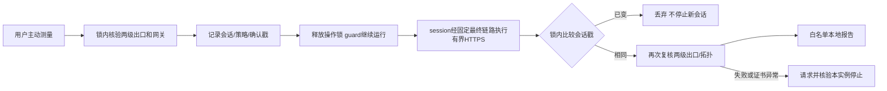

# 有界网络测量交付与验证

基线 0.12.1，`04b64bb450090e51246764bef8de8825146e2caf`。当前为开发候选；跨平台、最终源码与同次发布结果完成后补记。文件风险和边界见 [审计](network-measurement-plan.zh-CN.md)。跳过或未运行不计为通过。

## 1. 修改概述

增加主动、有限的最终链路 HTTPS 测量和本地报告，补充 Windows/WSL2 实机验收步骤。保留既有双出口、guard、沙箱、DPAPI、身份/预算、数据及可选 Desktop 退出。不增加生产依赖、权限、端口、镜像配方或许可证变更。

## 2. 源代码文件

`network_performance.py` 处理审计入口、前后核验、会话戳、字段白名单与统计；`resources/checks/network_probe.py` 是固定目标的标准库 HTTPS CONNECT 客户端；`engine.py` 提供独立入口。CLI、Qt 控制器/网络页增加主动按钮、缓存导出与失败状态；新增性能核心/CLI/Qt 单元和 `integration_network_transfer.py`，扩展实际 Engine 身份集成、DPI、冻结资源及发布门禁。

## 3. 核心架构与技术方案



不使用第一跳通用测速入口；只接受已审计网关的 IPv4:2080，不读取系统代理环境、不解析宿主 DNS、不接受自定义目标或跳过 TLS。子进程硬时限应对慢响应头；三次载荷及多读检测字节有上限。证书错误或安全复核失败不发布速度结果；目标拒绝/超时而复核健康可保留 partial。数据/镜像无需迁移。

## 4. 已实现功能

按需 GUI/CLI、两次新建 HTTPS 首字节、一份 1 MiB 下载、固定服务和流量/时间说明；结果/失败单位、脱敏导出、旧结果清除、前后独立核验、不阻塞 guard、切换竞态丢弃、真正退出等待收尾。见 [使用](network-measurement.zh-CN.md)和 [实机步骤](windows-acceptance.zh-CN.md)。

## 5. 测试命令与实际结果

```bash
python tools/check_repository.py
PYTHONPATH=src python -m unittest discover -s tests -v
PYTHONPATH=src python tools/smoke_gui.py
PYTHONPATH=src python tools/check_ui_dpi.py
docker build -f tools/Dockerfile.proxy-test -t spx-proxy-test .
docker run --rm --network none --read-only --tmpfs /tmp:rw,nosuid,nodev,size=128m --cap-drop ALL --security-opt no-new-privileges --pids-limit 256 --memory 512m --entrypoint python3 spx-proxy-test -u /opt/spx-test/integration_network_transfer.py --core /usr/local/bin/sing-box --output /tmp/network-transfer.json
```

本地 Linux ARM64 365 项（353 通过、12 项 Windows 专用跳过）、Qt smoke、200% 布局及新测速控件通过。21 项性能核心/CLI/Qt 测试覆盖字段/计数/单位、强制代理、NO_PROXY、未知目标参数不回显、操作锁释放、前后失败/证书异常停止、会话改变不停止替换环境、旧结果不冒充本次、缓存导出及退出等待。

真实 Python 3.12 + 官方 sing-box 1.14.3 的无网络 Docker 中，9 场景通过：生产客户端实际经 Adapter 和认证落地完成精确载荷；错误 CA、可信但名称错误证书拒绝；302 不跳转；错误长度、gzip、超量流拒绝且有界；慢响应头无法延长总预算；落地停止后健康目标无新请求。临时 CA 只用于夹具，没有关闭证书/名称验证或发公网请求。测试专用 daemon 已停止。

真实 Engine 的公网目标结果、Windows/冻结程序及完整安全回归待云端验证；服务拒绝/超时不能算成功测速。只有同次完整发布门禁成功才发布。

## 6. 修改前后性能对比

默认不测速，无新后台任务或镜像；只在用户明确触发时产生有界请求。首字节包含 CONNECT/TLS/服务响应，速率只有一份小响应，不测真实 AI、noVNC、物理 Windows/WSL2 或线路上限。后续填入同机 0.12.1/候选三组宿主和容器阶段原始测量，不预设提升比例。

## 7. 遗留问题

固定公网目标可能限流或不可用。CI 临时 CA/本地代理夹具不代替实际服务商、Windows/WSL2/v2rayN、真实 AI 和交互显示的长期验收。安全检查与目标服务器看到的公网地址并非同一观测，不能保证服务商所有目的地分流一致。签名与独立安全审计仍未完成。

## 8. 下一批任务

依据实机六阶段与长时记录处理已证实的性能和兼容问题，区分模型服务、代理路径、显示链路与 WSL 共享资源。真实设备、账号、签名和外部审计需要对应条件；不以关闭监测、TLS 或沙箱换取数字。
