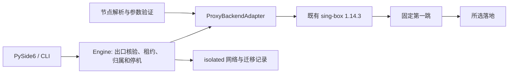

# 第二批 P1 交付与验证

基线：0.8.4，`32c4cdff4641eb3bdea773f3a8ec897aadae9be8`。日期：2026-11-10。本记录是项目自身验证，不能替代独立安全审计或每台 Windows/Docker Desktop/WSL2 的实机验收。

## 1. 修改概述

抽出代理后端，扩展 Reality、WS/gRPC、Hysteria2 和常见 Clash/Mihomo 节点；用 isolated bridge 补足普通 internal 网络的宿主服务边界，加入可恢复迁移。按用户追加要求实现关闭到托盘和明确的退出方式。0.8.4 的旧浏览器自动清理、通用第三方终端、沙箱和凭据保护一并保留。

## 2. 源代码与依赖

| 位置 | 用途 |
| --- | --- |
| `src/enge_spx/backends/` | Adapter 合约、sing-box 固定链路生成与不兼容 UDP 组合拒绝 |
| `nodes.py`、`node_options.py` | URI/JSON/Clash 参数校验、敏感错误处理、旧 ID 兼容 |
| `network_policy.py`、`engine.py` | 网络策略、版本化迁移和回滚、DNS 审计、既有租约与停机控制 |
| `gui.py`、`ui/window.py` | 托盘隐藏、恢复与退出；GUI 工作线程机制保留 |
| `tests/test_node_protocols.py`、`test_proxy_backends.py`、`test_network_policy.py`、`fixtures/nodes-0.8.4.json` | 参数、固定路由、旧规范节点/ID 和权限拒绝回归 |
| `tests/integration_protocols.py`、`integration_network_policy.py`、`integration_chain.py` | 实际 TLS/QUIC、链路、断线、DNS 和迁移测试 |
| `tests/test_window_frame.py`、`desktop_harness.py` | 关闭到托盘、恢复、显式退出与打包入口检查 |
| `tests/test_migration.py`、`test_monitor_reliability.py` | 新旧 guard 交接、停止信号和写入失败仍关闭容器 |
| `tools/Dockerfile.proxy-test`、P1/正式 CI | 原生核心与测试容器；正式 Windows 打包及运行时门禁 |

源代码路径除特别注明外相对 `src/enge_spx/`。没有新增生产 Python 包、代理核心、宿主监听端口或常驻重复容器。测试专用镜像包含 OpenSSL 以生成临时证书，不交付给应用用户。项目 PolyForm Noncommercial、已有 sing-box/Qt 等许可证及第三方声明保持不变。

## 3. 核心方案



新协议只改变受验证的出站参数；导入规则不能生成 DIRECT 或备用选择器。Reality 校验公钥/SNI/short ID/flow，Hysteria2 在 QUIC/UDP 上实际传输。浏览器 userns/seccomp、DPAPI、stdin/RAM 凭据边界保留。

迁移记录 schema=1，变更前写入，先停止再重连，保留 session/project ID 和可写层。失败仅恢复停止状态的旧元数据，不以旧策略继续运行。健康运行时继续审计 isolated、IPv6、session DNS、工作区 namespace 与两级出口。

重新检查时先保持停止状态，等待上一 guard 释放锁，再允许新策略进入 review/ready；这同样适用于已有 ENGE SPX 标记的版本升级。新 guard 每秒仅检查非敏感停止标记，网络复核仍每 30 秒执行，租约与失联期限不变。停止标记写入失败也会继续撤销租约和关闭容器，再报告错误。

## 4. 已实现与明确限制

新增协议、固定落地组合、Clash/Mihomo 节点导入和托盘行为见 [使用与升级说明](proxy-p1.zh-CN.md)。Hysteria2 不能套当前 TCP-only 本机转发；未知插件、跳端口、XHTTP/KCP、gRPC multi-mode 和其它未经验证的扩展明确拒绝。远程 provider、Clash DNS、自动回退规则不执行。

默认仍共享工作区工具身份和浏览器 Profile；项目文件仍按现有读写挂载。资源预算、多 Profile、网络环境诊断属于后续批次，不在本批宣称完成。

## 5. 测试命令与实际结果

```bash
python tools/check_repository.py
PYTHONPATH=src python -m unittest discover -s tests -v
PYTHONPATH=src python tests/integration_protocols.py --core /path/to/sing-box --output protocols.json
PYTHONPATH=src python tests/integration_network_policy.py --context default --output network.json
PYTHONPATH=src python tests/integration_chain.py --context default
```

同版本 [P1 CI](https://github.com/engeeeee/ENGE-SPX/actions/workflows/proxy-p1.yml) 在 Windows/Linux Python 3.12 发现 201 项单元测试；按平台跳过对应专属项。旧规范节点和 ID 的黄金样例使用明确 UTF-8 读取，修复了 Windows 测试读取编码差异。Linux ARM64 本地同样发现 201 项，191 通过、10 项 Windows 检查跳过。

协议集成使用真实官方 1.14.3 核心与临时 TLS/Reality/QUIC 服务端，共 124 条通过记录，不接触真实用户账号、不禁用 TLS。Docker 版本在 `network=none`、非 root、只读根、全部 capabilities 移除和 no-new-privileges 下执行；只有夹具服务端允许 direct，客户端始终使用实际 Adapter。检查普通/WS/gRPC、Reality/Vision、Hysteria2、salamander、4 KiB UDP 分片、远程名称解析、SOCKS/HTTP(S) 固定落地及两个独立来源地址。错误 CA、名称、认证、Reality key/short ID、已建立 QUIC 丢包及第一跳断线都要求目标无新请求；断线时落地仍健康。完整 Engine 还实际确认 Hysteria2 第一跳与 SOCKS 落地的两个公网出口，切断 UDP 服务后保持落地健康，要求环境停机。

原生 Linux Docker 网络测试实际验证：普通 internal 可以访问宿主 TCP/UDP 夹具；升级后不能访问；原始 DNS/UDP、IPv6 和 Docker 内部 DNS 均不能旁路到健康外部 DNS 夹具。还覆盖在线资源先停止、容器/可写层保留、重连错误回滚、进程中断续迁、其它归属端点拒绝。

正式 [Windows/运行时 CI](https://github.com/engeeeee/ENGE-SPX/actions/workflows/ci.yml) 继续要求完整 renderer、OAuth 回调/Cookie/Storage、190 秒续租、双跳异常停机、迁盘、两种镜像存储、冻结 Windows DPAPI、GUI/DPI、手动 Docker 启动和安装卸载验证通过后才发布。实际逐项结果以对应提交的 Actions 为准，不把平台跳过项或语法检查算作协议实测。

## 6. 性能对比

没有新增核心进程或生产依赖，运行镜像配方不变，合格旧镜像可以复用；内部网络升级只执行一次。常态仍为一个网关和原有工作容器，浏览器按需启动，退出界面可由既有 guard 继续维护。新增网络审计没有取消必要监控。

本批未在同一 Windows/WSL2 主机采集完整 CPU、内存、吞吐和启动时间前后对比，不承诺提速百分比。新协议的加密、传输和网络质量不同，受控夹具成功不能代表公网速度。系统化资源/性能基线与预算由第三批交付。

复用已有 `tools/benchmark_p0.py --kind host --baseline 32c4cdff4641eb3bdea773f3a8ec897aadae9be8`，在同一 Linux ARM64 / Python 3.14.4 / Qt offscreen 主机连续进行三组独立进程对照。测量候选为 `8efb10a`，未运行 Docker、托盘或 guard；后续停止信号修复没有在此实验中被测量。中位数如下，原始记录见 [JSON](benchmarks/p1-host-linux-arm64.json)：

| 指标与对象 | 0.8.4 | 0.9.0 候选 |
| --- | ---: | ---: |
| GUI 导入、构造与首次绘制 | 221.772 ms | 194.387 ms |
| GUI 空闲 CPU（单核百分比） | 0.1225% | 0.1361% |
| GUI 工作集 | 88.35 MiB | 89.66 MiB |
| Engine 构造 | 1.702 ms | 1.848 ms |
| 20 个合成节点及设置持久化 | 6,643 B | 6,643 B |

样本少、运行顺序固定，存在缓存和调度影响；表格只报告观测值，不推导 Windows 提速、WSL2 资源降低或公网吞吐提升。

## 7. 遗留问题

用户的 Docker Desktop/WSL2、真实服务商、v2ray 分流和账号环境仍需实机复测；没有物理 Windows 内核矩阵或真实云账号自动验收。Reality 与实现特有的新增扩展不能视为全部互通；不支持项须使用兼容配置，不能关闭 TLS 或沙箱来绕过。

TLS CA 只在节点内显式信任，不能代表已审计其来源。Docker/宿主管理员和同账户恶意程序仍超出防护边界；默认身份共享和项目读写范围未改变。

## 8. 下一批

第三批实施应用/容器/WSL2 资源来源监控、可视化 CPU/内存预算、低资源模式与测量；继续保留网络监测。随后才推进工作区 Profile 隔离和可导出的网络环境诊断。
