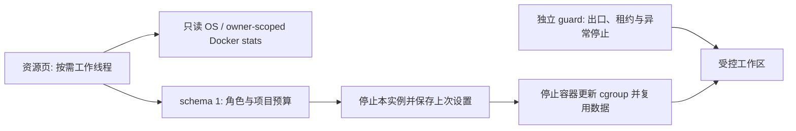

# 第三批：资源管理交付与验证

基线为 0.9.0，`1de64dd76a61ac4fa5f86e28f5bae10a964aced9`。保留 P0/P1 安全机制，不新增生产依赖、不修改项目或第三方许可证。具体风险与文件顺序见 [实施方案](resource-p1-plan.zh-CN.md)。

## 1. 修改概述

增加可见占用来源、版本化预算、独立项目预算、低资源模式及浏览器独立生命周期，并完善默认停止工作区的退出流程。减少后台界面刷新与重复项目设置写入，继续复用镜像、容器、连接与持久数据。

## 2. 源码位置

| 文件 | 用途 |
| --- | --- |
| `src/enge_spx/resource_limits.py` | schema、角色/项目校验、Docker 参数和停止更新 |
| `src/enge_spx/process_metrics.py` | Win32/Linux 只读计数、PID 创建标识与可选登记 |
| `src/enge_spx/resource_monitor.py` | 有界 owner 过滤、批量容器计数与来源分离 |
| `engine.py`、`relay.py`、`forward.py`、`__main__.py` | 预算保存恢复、容器复用、浏览器停止、后台记录与 CLI |
| `ui/controller.py`、`ui/window.py`、`ui/widgets.py`、`ui/style.py` | 概览/预算页面、工作线程、采样生命周期、退出状态机与统一控件 |
| `platform_ui.py` | 同实例恢复请求交由 Qt 处理，保持窗口可见性与快捷键状态同步 |
| `tests/test_resource_*.py`、`test_resources.py` | 校验、数据保持、原生 API、GUI/CLI 和故障检查 |
| `tests/test_exit_lifecycle.py`、`desktop_harness.py` | 默认停止、显式保留、任务取消/等待、迁移接管、失败重试、采样收尾及真实 Ctrl+Q 退出 |
| `tests/integration_resources.py`、`integration_runtime.py` | 真实 cgroup、应用失败、正常模式恢复、浏览器暂停/恢复与既有安全回归 |
| `tools/benchmark_p0.py`、`benchmark_resources.py`、CI | 同机交替顺序的三组宿主样本及容器阶段对照 |

未标根的应用路径相对 `src/enge_spx/`。容器镜像配方保持不变，不新增常驻容器或宿主监听端口。

## 3. 架构与方案



资源采样不调用 ready、不续租、不替代安全监控。保存预算先停止；更新失败不能启动未应用预算的容器。仅清除网关已有内存上限时可替换无用户数据的网关，项目可写层保留。独立浏览器停止通过公开状态标记使显示服务退出，不停止 CLI 或网关。

按发布前追加要求完善退出：X 入托盘；真正退出默认停止本实例，等待当前任务、独立服务锁和资源采样，验证没有运行容器后才关闭。失败保留界面可重试；保留工作区须显式确认。迁移后的路径接管不能被退出请求跳过，不再执行退出中的交互确认/后续任务。[完整规则](exit.zh-CN.md)。

## 4. 已实现

正常/低资源/自定义、CPU 与内存表单、单项目覆盖、上次设置恢复、应用/容器/主机/Desktop/WSL2 来源展示、仅概览可见时采样、单独浏览器停止和显式自动启动开关。旧默认、手动 Docker 启动、托盘、所有代理协议与安全约束保留。操作见 [使用说明](resources.zh-CN.md)。

## 5. 测试与命令

```bash
python tools/check_repository.py
PYTHONPATH=src python -m unittest discover -s tests -v
PYTHONPATH=src python tools/smoke_gui.py
PYTHONPATH=src python tests/integration_resources.py --context default --output resource-results.json
PYTHONPATH=src python tests/integration_runtime.py --context default --output integration-results.json
PYTHONPATH=src python tools/benchmark_resources.py --context default --runtime-report integration-results.json --output resources-docker.json
python tools/benchmark_p0.py --kind host --baseline 1de64dd76a61ac4fa5f86e28f5bae10a964aced9 --output host.json
```

本地 Linux ARM64 已通过真实 cgroup 的七条场景：仅停止本实例、独立预算真实生效、ID/可写文件保留、采样归属与实际计数、无效预算不停止工作、更新失败/配置恢复，以及恢复正常预算和完全停止。初始 Windows/Linux 专项 CI 同样通过，并验证 Win32 查询不泄漏句柄。

最终候选 `89c0d0` 的 [资源专项 CI](https://github.com/engeeeee/ENGE-SPX/actions/runs/42854261444) 与 [完整 PR CI](https://github.com/engeeeee/ENGE-SPX/actions/runs/42854452913) 均已通过，合入 `35cb2ee`（应用与工具源码相同）：

| 验证 | 实际结果 |
| --- | --- |
| Windows 单元 | 240 项，236 通过、4 项平台条件跳过 |
| Linux 单元 | 240 项，229 通过、11 项 Windows 专属跳过 |
| Windows GUI/冻结程序 | 多档 DPI、手动 Docker 启动、X 入托盘、第二次启动恢复、Ctrl+Q 默认停止退出、DPAPI、安装卸载通过 |
| 真实 cgroup | 七条场景通过，实际预算、ID/可写层保留、失败恢复、无关工作负载不受影响 |
| Docker 工作区 | 实际 renderer 沙箱与初始化失败拒绝、凭据边界、Cookie/Local Storage、中文 PTY、190 秒独立续租、浏览器暂停/CLI 使用/恢复、迁移后完整停止核验通过 |
| 网络与协议 | 原有 124 条协议场景及 DNS/UDP/IPv6、双出口、双跳故障、Hysteria2 UDP 故障回归通过 |
| 资源基准 | 基线/正常/低资源的全部阶段完成，完全停止后均无运行的所属容器 |

[主分支发布 CI](https://github.com/engeeeee/ENGE-SPX/actions/runs/42857042274)已对发布提交重新验证，Windows/Linux、冻结程序、真实容器与两种 Docker 存储导入均通过；发布任务只采用该次验证后的制品并重新核验摘要。PR 中按规则跳过的发布、归档导入不计为 PR 已通过；平台跳过不算通过。宿主与容器原始 JSON 保存在上述对应运行的 Artifact。

## 6. 性能对照

宿主比较复用原有工具，Windows/Linux 各进行三组同机进程对照，并交替 baseline/candidate 顺序。记录首绘、GUI 空闲 CPU/工作集、设置 I/O 和磁盘大小。较短 Windows CPU 样本可能低于计时分辨率，0 不代表真正零开销；不能用单次冷/热启动差异推导提速百分比。

容器对照顺序为 baseline-normal、candidate-normal、candidate-low，使用同一批已核验镜像与独立临时数据目录。分别记录启动前、容器空闲、默认启动工具后、真实 Claude/Codex `--version` 子进程的 CPU/峰值内存、独立合成 CPU/磁盘负载、实际 Chromium canvas 活动、仅停止浏览器，以及完全停止后的容器计数和宿主计数。镜像层、Profile 和应用文件单独记录；预算不是预留量。

阶段夹具不包含真实 AI 服务请求或已连接的 noVNC 客户端；Linux Docker 结果不能当作物理 Windows/WSL2 基线。宿主总计包括观察器、测试代理与其它 runner 进程，有观察开销、缓存和执行顺序影响。原始 JSON 保存在对应 CI Artifact；本记录不预设提升比例。

### 已完成的同机测量

宿主取最终候选资源专项中的三组中位数，基线均为 `1de64dd`；Windows 是 Server 2025/Python 3.12.10，Linux 是 x86_64/Python 3.12.16。GUI 空闲样本约五秒，CPU 为单核百分比。

| 对象/指标 | 0.9.0 | 0.10.0 候选 |
| --- | ---: | ---: |
| Windows GUI 导入、构建与首绘 ms | 354.0 | 300.2 |
| Windows GUI 空闲工作集 MiB | 82.0 | 80.3 |
| Windows GUI 空闲 CPU % | 0.309 | 0.614 |
| Linux GUI 导入、构建与首绘 ms | 166.5 | 149.6 |
| Linux GUI 空闲 RSS MiB | 88.6 | 89.5 |
| Linux GUI 空闲 CPU % | 0.151 | 0.351 |

首绘样本存在冷/热缓存与消息处理差异：Windows 基线范围 320.1–491.9 ms、候选 299.4–303.0 ms。上述结果不证明整体 CPU/内存都降低，不用短时计数推导长期占用。Windows 合成 20 节点数据目录为 7263→7902 bytes，Linux 为 6643→6794 bytes；这不是完整用户数据或 Docker 虚拟磁盘大小。

容器来自完整 PR CI 的同一 Linux Docker runner；每阶段内存取两次 Docker stats 采样的总和均值，仅包含本实例所属容器。**“CLI 容器空闲”是在执行 `true` 后采样，Claude/Codex `--version` 也会结束，不包含常驻 AI 工具或真实云端编程任务。**

| 容器阶段/内存 MiB | 0.9.0 正常 | 0.10.0 正常 | 0.10.0 低资源 |
| --- | ---: | ---: | ---: |
| 工具启动前，仅网关/会话 | 18.20 | 17.98 | 17.51 |
| 默认 CLI 容器启动后空闲 | 246.72 | 249.82 | 18.31 |
| 合成 CPU/磁盘活动 | 250.98 | 253.29 | 25.63 |
| 显式 Chromium canvas 活动 | 282.21 | 280.27 | 286.02 |
| 单独停止浏览器、保留 CLI | 无此 Engine 操作 | 28.82 | 28.49 |
| 完全停止 | 0 个运行所属容器 | 0 个运行所属容器 | 0 个运行所属容器 |

低资源默认未连带启动浏览器，因此工具容器启动的单次耗时为 1.02 秒，正常模式 3.51 秒、基线 3.19 秒；随后首次显式打开浏览器为 4.65 秒，正常模式已有浏览器的打开操作 0.68 秒，不能把两者当作相同的冷启动。两个哈希线程的合成阶段中，正常模式容器 CPU 总和约 200.48%，低资源约 100.25%，与单项目一核预算一致；CPU 限制可能延长任务，不表示计算效率提高。

离线 `claude --version` 三次启动中位数依次为 9.39/9.51/10.12 ms，`codex --version` 为 33.67/33.14/34.08 ms；这不代表模型请求、交互 TUI 或项目编译速度。两组正常模式 Profile 约 10.32 MB，低资源单次采样约 6.08 MB，时点不同，不代表 Profile 压缩或清理能力。各模式项目可写层同为 8,413,184 bytes（含合成 8 MiB 文件），镜像配方与共享镜像一致，未增加完整虚拟机或持续运行的重复容器。

完全停止后的容器采样不代表 Docker Desktop、WSL2 缓存或整个 Windows 主机内存为零。应用不强制关闭这些公共服务。

## 7. 遗留问题

物理 Windows/WSL2 的全机基线、真实 AI 编程任务、交互 noVNC 的长期带宽/CPU 仍需用户实机测量；测试不使用真实账号。WSL2 全局缓存回收依赖系统，应用不强制 shutdown。外部 Docker CPU 配置不兼容时保持停止而不重建项目。较低预算可能导致超时或 OOM；安全监控不因此停用。

多项目仍共享默认工具身份与浏览器 Profile，项目挂载权限未在此批更改。资源预算隔离不能当作账号隔离。

## 8. 下一批

第四批实现 Workspace Profile：按项目/身份隔离浏览器和 CLI 数据，显式读写/只读挂载与兼容迁移；随后补网络环境证据与脱敏诊断。保持本批预算与安全边界。
