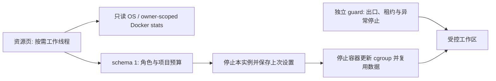

# 第三批：资源管理交付与验证

基线为 0.9.0，`1de64dd76a61ac4fa5f86e28f5bae10a964aced9`。保留 P0/P1 安全机制，不新增生产依赖、不修改项目或第三方许可证。具体风险与文件顺序见 [实施方案](resource-p1-plan.zh-CN.md)。

## 1. 修改概述

增加可见占用来源、版本化预算、独立项目预算、低资源模式及浏览器独立生命周期。减少后台界面刷新与重复项目设置写入，继续复用镜像、容器、连接与持久数据。

## 2. 源码位置

| 文件 | 用途 |
| --- | --- |
| `src/enge_spx/resource_limits.py` | schema、角色/项目校验、Docker 参数和停止更新 |
| `src/enge_spx/process_metrics.py` | Win32/Linux 只读计数、PID 创建标识与可选登记 |
| `src/enge_spx/resource_monitor.py` | 有界 owner 过滤、批量容器计数与来源分离 |
| `engine.py`、`relay.py`、`forward.py`、`__main__.py` | 预算保存恢复、容器复用、浏览器停止、后台记录与 CLI |
| `ui/controller.py`、`ui/window.py`、`ui/widgets.py`、`ui/style.py` | 概览/预算页面、工作线程、采样生命周期与统一控件 |
| `tests/test_resource_*.py`、`test_resources.py` | 校验、数据保持、原生 API、GUI/CLI 和故障检查 |
| `tests/integration_resources.py`、`integration_runtime.py` | 真实 cgroup、应用失败、正常模式恢复、浏览器暂停/恢复与既有安全回归 |
| `tools/benchmark_p0.py`、`benchmark_resources.py`、CI | 同机交替顺序的三组宿主样本及容器阶段对照 |

未标根的应用路径相对 `src/enge_spx/`。容器镜像配方保持不变，不新增常驻容器或宿主监听端口。

## 3. 架构与方案



资源采样不调用 ready、不续租、不替代安全监控。保存预算先停止；更新失败不能启动未应用预算的容器。仅清除网关已有内存上限时可替换无用户数据的网关，项目可写层保留。独立浏览器停止通过公开状态标记使显示服务退出，不停止 CLI 或网关。

## 4. 已实现

正常/低资源/自定义、CPU 与内存表单、单项目覆盖、上次设置恢复、应用/容器/主机/Desktop/WSL2 来源展示、仅概览可见时采样、单独浏览器停止和显式自动启动开关。旧默认、手动 Docker 启动、托盘、所有代理协议与安全约束保留。操作见 [使用说明](resources.zh-CN.md)。

## 5. 测试与命令

```bash
python tools/check_repository.py
PYTHONPATH=src python -m unittest discover -s tests -v
PYTHONPATH=src python tools/smoke_gui.py
PYTHONPATH=src python tests/integration_resources.py --context default --output resource-results.json
PYTHONPATH=src python tests/integration_runtime.py --context default --output integration-results.json
PYTHONPATH=src python tools/benchmark_resources.py --context default --runtime-report integration-results.json --output resources-docker.json
python tools/benchmark_p0.py --kind host --baseline 1de64dd76a61ac4fa5f86e28f5bae10a964aced9 --output host.json
```

本地 Linux ARM64 已通过真实 cgroup 的七条场景：仅停止本实例、独立预算真实生效、ID/可写文件保留、采样归属与实际计数、无效预算不停止工作、更新失败/配置恢复，以及恢复正常预算和完全停止。初始 Windows/Linux 专项 CI 同样通过，并验证 Win32 查询不泄漏句柄。

最终提交仍必须通过 Windows/Linux 单元、GUI/DPI、冻结 DPAPI/CLI/托盘、安装卸载、真实 renderer 沙箱、Cookie/Storage、190 秒续租、浏览器单独停止/CLI 使用与恢复、P1 的 124 条协议、防泄漏和双跳故障，以及两种 Docker 存储导入门禁。[第三批专项 CI](https://github.com/engeeeee/ENGE-SPX/actions/workflows/resources-p1.yml)保存宿主原始样本；[正式 CI](https://github.com/engeeeee/ENGE-SPX/actions/workflows/ci.yml)保存容器阶段数据并约束发布。实际结果以对应提交为准，平台跳过和未执行任务不算通过。

## 6. 性能对照

宿主比较复用原有工具，Windows/Linux 各进行三组同机进程对照，并交替 baseline/candidate 顺序。记录首绘、GUI 空闲 CPU/工作集、设置 I/O 和磁盘大小。较短 Windows CPU 样本可能低于计时分辨率，0 不代表真正零开销；不能用单次冷/热启动差异推导提速百分比。

容器对照顺序为 baseline-normal、candidate-normal、candidate-low，使用同一批已核验镜像与独立临时数据目录。分别记录启动前、容器空闲、默认启动工具后、真实 Claude/Codex `--version` 子进程的 CPU/峰值内存、独立合成 CPU/磁盘负载、实际 Chromium canvas 活动、仅停止浏览器，以及完全停止后的容器计数和宿主计数。镜像层、Profile 和应用文件单独记录；预算不是预留量。

阶段夹具不包含真实 AI 服务请求或已连接的 noVNC 客户端；Linux Docker 结果不能当作物理 Windows/WSL2 基线。宿主总计包括观察器、测试代理与其它 runner 进程，有观察开销、缓存和执行顺序影响。原始 JSON 保存在对应 CI Artifact；本记录不预设提升比例。

## 7. 遗留问题

物理 Windows/WSL2 的全机基线、真实 AI 编程任务、交互 noVNC 的长期带宽/CPU 仍需用户实机测量；测试不使用真实账号。WSL2 全局缓存回收依赖系统，应用不强制 shutdown。外部 Docker CPU 配置不兼容时保持停止而不重建项目。较低预算可能导致超时或 OOM；安全监控不因此停用。

多项目仍共享默认工具身份与浏览器 Profile，项目挂载权限未在此批更改。资源预算隔离不能当作账号隔离。

## 8. 下一批

第四批实现 Workspace Profile：按项目/身份隔离浏览器和 CLI 数据，显式读写/只读挂载与兼容迁移；随后补网络环境证据与脱敏诊断。保持本批预算与安全边界。
