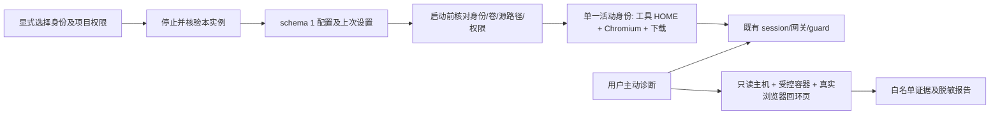

# 第四批：工作区身份与网络检查交付

基线 0.10.0，`6168bf406d9d7d6254e5be102921445f5129db48`。本记录在候选分支持续更新；未列为实际通过的检查不得视为完成。完整风险与文件计划见 [审计方案](workspaces-p2-plan.zh-CN.md)。

## 1. 修改概述

增加可选身份隔离和项目只读/读写授权，保留共享资料；补充按对象、有范围说明的网络证据和脱敏导出。没有增加生产依赖、常驻虚拟机、镜像层、容器权限或宿主监听端口，不改许可证。

## 2. 源码文件

| 文件 | 改动 |
| --- | --- |
| `src/enge_spx/workspace_profiles.py` | schema=1、初始化标记、严格身份/路径/卷/权限检查 |
| `engine.py`、`state.py`、`__main__.py` | 停止核验后应用/恢复、旧共享兼容、启动前审计、CLI 与安全导出 |
| `network_diagnostics.py` | 受控按需采样、独立出口耗时、字段白名单和逐报告地址代号 |
| `resources/checks/environment_probe.py`、`browser_probe.py`、`exit_probe.py` | 容器路由/有限阻断、真实浏览器回环观察、固定安全错误类别 |
| `ui/controller.py`、`ui/window.py`、`ui/style.py` | 身份/授权面板、工作线程、过期选择校验和懒加载诊断页 |
| `tests/test_workspace_*.py`、`test_network_*.py` | 旧版、配置损坏、串号、权限、UI/CLI、脱敏和故障覆盖 |
| `tests/integration_workspace_data.py`、`integration_profiles.py` | 真实卷、递归只读、账号/Cookie/Storage、恢复复用及断线停止 |
| `tools/check_ui_dpi.py`、打包元数据与 CI | 新控件 DPI、冻结资源/命令、跨平台和发布门禁 |

未标根的应用路径相对 `src/enge_spx/`。

## 3. 核心架构与技术方案



独立身份不复制旧资料。共享模式沿用旧命名和卷；同一项目的不同访问模式使用独立容器，保留旧可写层。配置丢失或损坏拒绝回到共享；恢复操作也需停止核验。Docker Desktop 原生路径及 8.3 别名使用严格 drive/路径匹配与 samefile，不采用后缀匹配。递归只读显式要求内核支持，不降级成可写。[Docker 递归只读条件](https://docs.docker.com/engine/storage/bind-mounts/#recursive-mounts)。

诊断复用双出口和拓扑保护。浏览器经短期容器回环页面观察，不开 DevTools；授权令牌只经 stdin 传入。白名单报告不读取项目、账号、Cookie、Storage 或原始 SDP。语言与时区只读；出现证实直连、出口复核失败或权限变化时请求并核验停止。

## 4. 已实现功能

身份新建/选择/绑定/恢复、独立浏览器/工具账号/下载、显式递归只读、启动前拒绝串号、默认共享兼容。主动诊断展示主机与容器路由/DNS、IPv4/IPv6/UDP 有限探测、系统与浏览器语言/时区、本地 WebRTC、独立线路/最终出口耗时及脱敏导出。操作见 [身份](workspaces.zh-CN.md)与 [网络检查](network-diagnostics.zh-CN.md)。

## 5. 测试命令与实际结果

```bash
python tools/check_repository.py
PYTHONPATH=src python -m unittest discover -s tests -v
PYTHONPATH=src python tools/smoke_gui.py
PYTHONPATH=src python tools/check_ui_dpi.py
PYTHONPATH=src python tests/integration_workspace_data.py --context default --output workspace-data.json
PYTHONPATH=src python tests/integration_runtime.py --context default --output integration-results.json
PYTHONPATH=src python tests/integration_profiles.py --context default --runtime-report integration-results.json --output workspace-profiles-results.json
PYTHONPATH=src python tools/benchmark_resources.py --baseline 6168bf406d9d7d6254e5be102921445f5129db48 --context default --runtime-report integration-results.json --output resources-docker.json
python tools/benchmark_p0.py --kind host --baseline 6168bf406d9d7d6254e5be102921445f5129db48 --output host.json
```

当前本地 Linux ARM64：286 项单元测试，275 通过、11 项 Windows 专用跳过；真实无网络 Docker 数据测试 6 场景通过。初始核心 `1235249` 的 [跨平台专项 CI](https://github.com/engeeeee/ENGE-SPX/actions/runs/42897634925) 已通过 Windows/Linux 268 项及真实数据测试，原生 Windows 路径别名问题已修正。网络诊断及最终候选的全量 CI、真实 Chromium 与打包结果待候选构建后记录；核心通过不代替这些门禁。

## 6. 性能前后对比

镜像配方和正常资源默认不变；未增加常驻容器/网络定时器。新身份增加按使用增长的磁盘数据，而非新的常驻 VM；一次只启用一个身份，切换有停止与再次核验开销。报告使用现有同机测量工具，对照 0.10.0，宿主三组交替次序、Docker 正常及低资源阶段结果待 CI 回填，不预设提速比例。

合成 CLI/浏览器负载不等于真实 Claude/Codex 任务，也不能代表物理 Windows、WSL2 整体内存或连接 noVNC 时的长期体验。

## 7. 遗留问题

- 默认共享和同一身份内仍共享账号，需用户选择不同身份。只读允许读取共同项目中的密钥；Docker 管理者和宿主仍是信任根，身份卷没有新增加密。
- 一次有限探测和无响应不能证明没有包发出；WebRTC 只观察本地候选与回环 STUN，不覆盖所有公网 STUN/TURN。GeoIP、时区和语言不能保证匿名，不进行指纹伪装。
- 固定环境时区继续沿用旧行为，语言只读；真实账号、多显示器、用户 Docker Desktop/WSL2/v2ray/终端组合仍需实机交互验收。Windows 未代码签名，无独立安全审计。

## 8. 下一批开发任务

完成上述门禁后，后续优先根据实机反馈处理兼容问题；物理 Windows/WSL2 的长期工作负载、不同实际 AI 账号及磁盘数据增长测量仍需要用户环境。签名和独立安全审计需要相应外部条件。不以放宽沙箱、开放直连或全局修改系统换取兼容。
