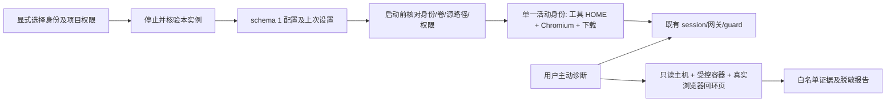

# 第四批：工作区身份与网络检查交付

基线 0.10.0，`6168bf406d9d7d6254e5be102921445f5129db48`。最终源码候选为 `1d5cf9f`；发布资产须经过主分支的同次门禁，已跳过的检查不计为通过。完整风险与文件计划见 [审计方案](workspaces-p2-plan.zh-CN.md)。

## 1. 修改概述

增加可选身份隔离和项目只读/读写授权，保留共享资料；补充按对象、有范围说明的网络证据和脱敏导出。没有增加生产依赖、常驻虚拟机、镜像层、容器权限或宿主监听端口，不改许可证。

## 2. 源码文件

| 文件 | 改动 |
| --- | --- |
| `src/enge_spx/workspace_profiles.py` | schema=1、初始化标记、严格身份/路径/卷/权限检查 |
| `engine.py`、`state.py`、`__main__.py` | 停止核验后应用/恢复、旧共享兼容、启动前审计、CLI 与安全导出 |
| `network_diagnostics.py` | 受控按需采样、独立出口耗时、字段白名单和逐报告地址代号 |
| `resources/checks/environment_probe.py`、`browser_probe.py`、`browser_shutdown.py`、`exit_probe.py` | 容器路由/有限阻断、真实浏览器回环观察、固定安全错误类别 |
| `ui/controller.py`、`ui/window.py`、`ui/style.py` | 身份/授权面板、工作线程、过期选择校验和懒加载诊断页 |
| `tests/test_workspace_*.py`、`test_network_*.py` | 旧版、配置损坏、串号、权限、UI/CLI、脱敏和故障覆盖 |
| `tests/integration_workspace_data.py`、`integration_profiles.py` | 真实卷、递归只读、账号/Cookie/Storage、恢复复用及断线停止 |
| `tools/check_ui_dpi.py`、打包元数据与 CI | 新控件 DPI、冻结资源/命令、跨平台和发布门禁 |

未标根的应用路径相对 `src/enge_spx/`。

## 3. 核心架构与技术方案



独立身份不复制旧资料。共享模式沿用旧命名和卷；同一项目的不同访问模式使用独立容器，保留旧可写层。配置丢失或损坏拒绝回到共享；恢复操作也需停止核验。Docker Desktop 原生路径及 8.3 别名使用严格 drive/路径匹配与 samefile，不采用后缀匹配。递归只读显式要求内核支持，不降级成可写。[Docker 递归只读条件](https://docs.docker.com/engine/storage/bind-mounts/#recursive-mounts)。

诊断复用双出口和拓扑保护。浏览器经短期容器回环页面观察，不开 DevTools；授权令牌只经 stdin 传入。白名单报告不读取项目、账号、Cookie、Storage 或原始 SDP。语言与时区只读；出现证实直连、出口复核失败或权限变化时请求并核验停止。

停止浏览器前向已核验的主进程请求 SIGINT，采用 [Chromium POSIX 的正常退出路径](https://chromium.googlesource.com/chromium/src/+/HEAD/chrome/browser/chrome_browser_main_posix.cc)，限时等待以便保存 Profile。只在已归属浏览器容器内核对当前 UID、主进程和固定 Profile 参数，不对 PID 1、renderer 或主机进程发信号。工作区停止仍先撤销网关；保存失败也继续容器限时停止，不以数据保存阻碍 Fail-Closed。

## 4. 已实现功能

身份新建/选择/绑定/恢复、独立浏览器/工具账号/下载、显式递归只读、启动前拒绝串号、默认共享兼容。浏览器停止前限时请求正常退出，保留强制停机路径，覆盖快速切换时的资料保存；非中文 Windows 管道中的 CLI JSON 采用可还原转义，避免中文身份名造成编码退出。主动诊断展示主机与容器路由/DNS、IPv4/IPv6/UDP 有限探测、系统与浏览器语言/时区、本地 WebRTC、独立线路/最终出口耗时及脱敏导出。操作见 [身份](workspaces.zh-CN.md)与 [网络检查](network-diagnostics.zh-CN.md)。

## 5. 测试命令与实际结果

```bash
python tools/check_repository.py
PYTHONPATH=src python -m unittest discover -s tests -v
PYTHONPATH=src python tools/smoke_gui.py
PYTHONPATH=src python tools/check_ui_dpi.py
PYTHONPATH=src python tests/integration_workspace_data.py --context default --output workspace-data.json
PYTHONPATH=src python tests/integration_runtime.py --context default --output integration-results.json
PYTHONPATH=src python tests/integration_profiles.py --context default --runtime-report integration-results.json --output workspace-profiles-results.json
PYTHONPATH=src python tools/benchmark_resources.py --baseline 6168bf406d9d7d6254e5be102921445f5129db48 --context default --runtime-report integration-results.json --output resources-docker.json
python tools/benchmark_p0.py --kind host --baseline 6168bf406d9d7d6254e5be102921445f5129db48 --output host.json
```

源码候选 `1d5cf9f` 的 [工作区专项 CI](https://github.com/engeeeee/ENGE-SPX/actions/runs/42908647953) 全部通过：Windows 292 项（288 通过、4 项 Linux 专用跳过），Linux 292 项（281 通过、11 项 Windows 专用跳过）；真实 Docker 数据 6 场景；校验导入原 0.10.0 运行镜像后，7 项真实沙箱 Chromium/身份/诊断场景通过。镜像配方与 0.10.0 完全一致，未重建镜像也能正常快速回切。

真实结果包括：新身份账号/Cookie/Storage/下载为空，递归只读写入返回 EROFS，显式读写可写入；切回保留原账号、Cookie/Storage、下载、项目 ID 与可写层；过期其它身份 attach 被拒绝。实际浏览器 en-US、America/Los_Angeles/UTC−8 与 session 一致，WebRTC 创建 offer 成功、本地候选为空且回环 STUN 接收为 0。报告脱敏、guard 保持、无新增宿主 socket 或容器公开端口。实际断开网关外联后诊断失败并核验本实例停止，其它实例仍运行。以上为合成账号与本地登录夹具，不代表真实 AI 服务登录验证。

本地 Linux ARM64 292 项及 6 场景数据测试同样通过，GUI/200% 紧凑布局通过。完整 [Windows 安装包与安全回归](https://github.com/engeeeee/ENGE-SPX/actions/runs/42908659672) 已通过：两平台单元、125/150/200% DPI 与完整身份控件、冻结 Python 3.12 CLI/GUI、真实 DPAPI 迁移/显式回滚/删除、默认手动 Docker 启动、真实托盘与 Ctrl+Q、安装/卸载保留数据；真实 cgroup、网络迁移/回滚/DNS/UDP/IPv6、124 项协议/TLS/Reality/gRPC/QUIC 夹具、完整 Chromium 沙箱/中文 PTY/190 秒续期、独立浏览器停止/恢复、真实 Cookie/Storage、数据搬迁、停止及无沙箱失败拒绝；真实双跳/Hysteria2 断线保护、7 项新构建镜像身份/诊断场景，以及全部资源测量阶段。

PR 中按规则跳过的导出、两种镜像存储导入和发布不计为 PR 已通过；合入主分支后由相同流水线重新验证，只有该次 Windows/Linux/容器/打包和两种存储导入全部成功，才自动发布并核验制品摘要。测试和性能原始 JSON 保留在上述运行 Artifact，源码与测试不因最终文档记录而更改。

发布提交为 `42a3aa7c93c612be4ad591043724d876ad8c7d28`，对应 [主分支发布 CI](https://github.com/engeeeee/ENGE-SPX/actions/runs/42911715618) 全部成功。该次 Windows/Linux、冻结安装包、真实运行与身份回归、协议和资源测试均重跑通过；原生 containerd 与独立经典存储都实际下载、校验、导入同次导出的包，并验证重复安装、旧标签和容器数据保留。发布任务仅采用同次制品。

[0.11.0 Preview](https://github.com/engeeeee/ENGE-SPX/releases/tag/v0.11.0-windows) 已公开 7 个资产。发布后再次实际下载安装版和便携版：分别为 32,393,140 B 和 50,839,530 B，SHA-256 与发布摘要/校验文件一致，便携包全量 ZIP CRC 通过，三个新增检查资源齐全。运行镜像清单 schema、版本、平台、三种配方/标识、875,937,637 B 大小与公开摘要相符；不再重复下载整个镜像归档，其实际导入证据来自上述同次双存储门禁。

| Windows 资产 | 实际下载 SHA-256 |
| --- | --- |
| Setup.exe | `082c2ae5d4b10f62236b9cb36a994d89134d18165a8fcd7e0f81af40bfcf5cb4` |
| Portable.zip | `78b57017362497cba896eec1194982f5ce110d113b75322708b601387175ff13` |

## 6. 性能前后对比

镜像配方和正常资源默认不变，未增加常驻容器/网络定时器。同一专项 CI、Python 3.12、默认共享模式与 20 个合成节点，对照 0.10.0；三组 baseline/candidate 交替次序，以下为中位数。GUI 空闲每组约 5 秒，CPU 为单核百分比，工作集为测量结束时的 OS 计数：

| 指标 | Windows 0.10.0 → 候选 | Linux 0.10.0 → 候选 |
| --- | --- | --- |
| GUI 导入/构造/首次绘制 | 373.350 → 243.086 ms | 206.304 → 176.394 ms |
| GUI 空闲 CPU | 0.6096% → 0.6071% | 0.3759% → 0.3695% |
| GUI 工作集 | 83.34 → 83.11 MiB | 89.88 → 90.36 MiB |
| 合成默认配置持久数据 | 7,902 → 7,902 B | 6,794 → 6,794 B |

这些短样本受 VM、冷暖缓存、调度和 working-set trimming 影响。基线来自新解压的源码归档，候选来自已运行测试的工作树，字节码/文件缓存条件可能不同；首绘差异不能独立归因于代码提速。不推导固定提升比例，也不代表所有用户资源下降。Linux 的工作集略增。宿主测量未启动 Docker，配置字节数不包含新身份实际账号/浏览器缓存。冻结 Windows 安装包另测一次首次绘制为 897 ms，无同条件旧安装包样本，不作前后提速比较。

原 0.10.0 镜像的真实身份测试：仅有 1 个 project、1 个 browser、1 个 session、1 个 gateway 运行，容器内存合计单次约 288.92 MiB。四次身份应用的停止核验及配置保存为 1.46–1.90 秒，不含随后重检/确认及启动，且不是物理 Windows 结果。新身份的数据随使用增长，未复制完整 VM；停止的卷和可写层保留。

同一 Linux Docker runner 上，三个独立 worker 依次运行 0.10.0 正常、候选正常、候选低资源，复用同一批只读镜像、分别使用临时数据目录。下表为每阶段两次 Docker stats 的所属运行容器总和均值，减去了部分缓存；不是 WSL2 全机内存：

| 容器阶段/内存 MiB | 0.10.0 正常 | 候选正常 | 候选低资源 |
| --- | ---: | ---: | ---: |
| 工具启动前，网关/会话 | 18.30 | 18.11 | 17.81 |
| 默认工具容器启动后空闲 | 248.57 | 249.94 | 18.57 |
| 合成 CPU/磁盘活动 | 253.62 | 254.37 | 25.49 |
| 显式 Chromium canvas 活动 | 281.05 | 281.74 | 280.03 |
| 单独停止浏览器，保留 CLI | 28.88 | 29.10 | 28.43 |
| 完全停止 | 0 个运行容器 | 0 个运行容器 | 0 个运行容器 |

低资源默认未启动浏览器，工具容器准备的单次耗时为 1.07 秒，正常为 3.16 秒、基线为 3.30 秒；随后低资源首次显式打开浏览器为 4.85 秒，正常的已运行浏览器操作为 0.62 秒，不能作为同条件冷启动比较。合成双哈希线程 CPU 总和正常约 201%、低资源约 100%，符合一核限额，任务可能因此变慢。

离线 `claude --version` 三次启动中位数为 10.09/9.88/10.69 ms，`codex --version` 为 35.25/34.69/33.57 ms，不包含常驻交互工具、真实模型请求或代码编译。正常内存没有全面下降；单独停止浏览器的单次耗时从 0.25 秒变成 0.87 秒，包含新的提前保存步骤，快速切换 Cookie 已在真实测试中恢复。

三组项目可写层同为 8,413,184 B（包含合成 8 MiB 文件）；浏览器 Profile 采样约 9.40/10.32/6.08 MB，时点/缓存不同，不代表压缩或清理。停止后应用数据约 918,763/918,762/919,214 B，未包括所有 Docker 卷和虚拟磁盘。全部停止只证明本实例没有运行容器；Docker Desktop、WSL2 和内核缓存不会因此必然归零，也不会被应用强制关闭。

合成 CLI/浏览器负载不等于真实 Claude/Codex 任务，也不能代表物理 Windows、WSL2 整体内存或连接 noVNC 时的长期体验。

## 7. 遗留问题

- 默认共享和同一身份内仍共享账号，需用户选择不同身份。只读允许读取共同项目中的密钥；Docker 管理者和宿主仍是信任根，身份卷没有新增加密。
- 一次有限探测和无响应不能证明没有包发出；WebRTC 只观察本地候选与回环 STUN，不覆盖所有公网 STUN/TURN。GeoIP、时区和语言不能保证匿名，不进行指纹伪装。
- 固定环境时区继续沿用旧行为，语言只读；真实账号、多显示器、用户 Docker Desktop/WSL2/v2ray/终端组合仍需实机交互验收。Windows 未代码签名，无独立安全审计。

## 8. 下一批开发任务

完成上述门禁后，后续优先根据实机反馈处理兼容问题；物理 Windows/WSL2 的长期工作负载、不同实际 AI 账号及磁盘数据增长测量仍需要用户环境。签名和独立安全审计需要相应外部条件。不以放宽沙箱、开放直连或全局修改系统换取兼容。
