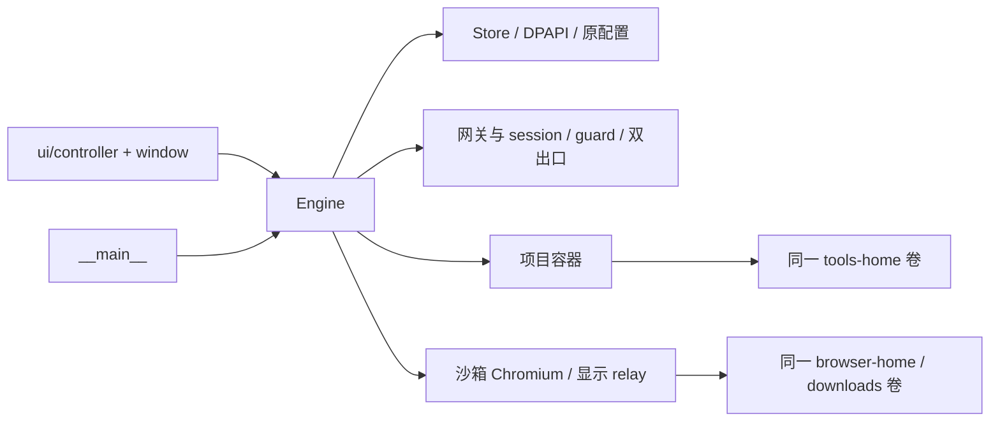

# 第四批源码审计与实施顺序

基线：0.10.0，`6168bf4`。保留 Python 3.12+、PySide6 和 Docker Desktop/WSL2，不增加生产依赖、完整虚拟机、容器权限或宿主监听端口。先完成身份和文件授权，再实现按需诊断。

## 当前依赖与实际缺口

- `_project` 按项目路径命名容器，但所有项目挂载同一 `tools-home`；Claude/Codex 的整个 HOME、授权和缓存随卷共享。项目挂载默认读写。
- `_browser` 使用同一组 Profile/下载卷，停止后重建浏览器容器并保留卷。沙箱、凭据 stdin 传递、Cookie/Storage、浏览器独立停止已经存在，应复用。
- `policy`、`audit_topology`、`ready` 和 attach 的 session/container 校验已经阻止旧连接启动工具；需要将当前身份和项目授权纳入校验。
- 网络已有双出口、第一跳独立验证、DNS/UDP/IPv6 防泄漏测试及 WebRTC 限制策略；当前诊断以安装和启动状态为主，缺少有对象与证据的环境报告。
- 时区已有显式设置和 ZoneInfo 校验，容器和浏览器继承同一 TZ。工作镜像只有 en_US.UTF-8；保留英文系统语言与中文终端输入，不自动更改语言/时区或增加中文字体。

## 文件级实施

| 顺序 | 文件 | 内容 | 风险 / 复杂度 / 依赖 |
| --- | --- | --- | --- |
| 1 | `workspace_profiles.py`、`tests/test_workspace_profiles.py` | schema=1、默认共享、随机身份 ID、项目绑定/权限、命名与挂载审计、只含公开配置的恢复记录 | 高 / 中；需要严格防止错卷、未知 schema 及隐式回退 |
| 2 | `engine.py` | 复用停止核验，切换前停止；独立 HOME/Profile/下载卷、按身份和权限命名项目容器、policy 与 attach 校验 | 高 / 高；必须保留旧名称和容器可写层，停止失败不写新身份 |
| 3 | `__main__.py`、`ui/controller.py`、`ui/window.py` | 新建/选择身份、显式项目只读/读写、清晰的当前与待应用状态、配置恢复 | 中 / 中；选择本身不更改运行身份，不在 GUI 路径输入时访问网络文件系统 |
| 4 | `network_diagnostics.py`、`resources/checks/*` | 主机只读路由、受控容器 IPv4/IPv6/DNS、实际浏览器语言/时区/WebRTC、第一跳/最终出口探测耗时与脱敏导出 | 高 / 高；复用网关和 guard，严格区分配置/实测/未知，禁止调试端口和伪装 |
| 5 | 现有 CI、`integration_profiles.py`、Windows GUI/冻结检查 | 真实账号文件哨兵、Cookie/Storage、只读写失败、旧共享身份回切、跨身份 attach 拒绝、完整安全回归 | 高 / 高；测试账户为合成数据，不调用真实 AI 账号 |
| 6 | README、SECURITY、CHANGELOG、操作/迁移/验证文档 | 默认共享兼容、独立身份首次重新登录、回滚、检测范围和实际结果 | 中 / 低；不得把数据隔离等同于独立内核或匿名保证 |

## 数据边界与迁移

新 `workspace-profiles.json` 只保存 schema、身份 ID/显示名、当前身份和项目 hash→身份/权限的绑定，不保存账号密码。缺失文件时完全沿用旧共享模式和卷名。新身份从空卷开始，不自动复制已有 Cookie 或 CLI 凭据。一次只启用一个身份的工作区；切换先停止并核验，之后重新检查并确认连接。

项目容器按身份、项目和访问模式分别保留；改权限时不删除旧可写层。只读使用 Docker 的递归只读选项，条件不足时拒绝创建，不回退读写。Docker 对递归只读的内核条件见[官方绑定挂载说明](https://docs.docker.com/engine/storage/bind-mounts/#recursive-mounts)。

配置变更保留上次有效公开配置供显式恢复；数据卷始终保留。降级前必须停止并明确恢复默认共享模式，旧版只能使用原共享资料，不能管理新身份。直接复制新身份资料回共享模式不属于自动迁移。

## 网络诊断边界

仅由用户主动运行，不新增常驻采样。宿主不主动连接公网；容器主动探测仍处于已有受控网络，检测到实际绕过通道则停止。浏览器通过容器内部临时本地页面采集实际 API 结果，不启用远程调试或修改指纹。WebRTC 局部候选和受控本地 UDP 观察不冒充所有公网 STUN/TURN 的泄漏证明。Chrome 的策略含义见[上游 WebRTC 策略定义](https://chromium.googlesource.com/chromium/src/components/policy/+/main/resources/templates/policy_definitions/WebRtc/WebRtcIPHandling.yaml)。

导出使用字段白名单及每份报告独立的地址代号，不包含项目路径、代理地址、密码、浏览器令牌、原始 SDP、Cookie 或 Storage。检测失败、超时、不支持、未运行与确证异常分开显示。所有新功能完成代码、测试、文档和回归后再发布。
